# 时空可组合性的编程范式

## 1. 引言 (Introduction)

**组合（Composition）**——将较简单的部件组装成复杂系统——是软件工程的一条基本原则 [1]。传统上，组合是静态的：函数调用、模块导入以及类继承均在编译期解析，并在整个执行过程中保持固定。然而，现代软件越来越需要**动态组合（Dynamic Composition）**，即在运行时加载、卸载和重新配置组件。插件架构 [2] 和自演化智能体框架（self-evolving agent harnesses）都需要能够在运行过程中安全地添加和移除功能的系统；但当前的工程实践往往退而求其次，依赖粗粒度机制 [3]，只能通过重启来进行重配置，从而丢弃了运行时状态。尽管动态组合在实践中的重要性日益凸显，但与静态组合所拥有的丰富形式化框架相比，其理论基础仍然发展不足。

---

### 1.1. 可组合性的维度 (Dimensions of Composability)

为了刻画动态组合的需求，除了已被充分研究的组合代数方面之外，我们识别出两个正交的维度：

*   **时间可组合性（Temporal composability）** 关注时间维度：当移除某个组件时，该组件对共享环境所做的修改必须被彻底且安全地逆转（revert）。这要求追踪该组件执行的每一次资源分配、事件注册和状态变更，并保证在组件移除时对其进行有序回收。
*   **空间可组合性（Spatial composability）** 关注空间维度：组件必须能够以结构化且可验证的方式声明、发现并解析彼此之间的依赖关系。这要求管理依赖拓扑结构，并响应依赖关系的变化来协调组件的生命周期。

在静态环境中，时间可组合性退化为词法作用域（lexical scoping，例如 RAII [4]、bracket 模式 [5]），而空间可组合性退化为模块导入解析（module import resolution）[6]。在组件于运行时动态到达与离开的动态环境中，这两个维度都变得棘手得多：时间可组合性必须处理不受词法边界限制的长生命周期、有状态效应（stateful effects）；而空间可组合性则必须处理在执行过程中动态出现、消失或改变身份的依赖关系。

---

### 1.2. 动机示例 (Motivating Examples)

#### 1.2.1. 插件系统 (Plugin Systems)

插件系统是动态组合的一个典型实例。我们以最广泛使用的可扩展集成开发环境（IDE）之一——Visual Studio Code (VSCode) 作为代表性示例。

*   **时间局限性（Temporal limitation）：** VSCode 在一个名为“扩展宿主（extension host）”的共享进程中运行所有扩展。尽管扩展可以动态安装，但该宿主没有提供任何机制来在运行时卸载单个扩展的代码。一旦某个扩展的 `activate` 函数执行完毕，禁用或卸载它就需要重启整个宿主进程，从而影响所有已加载的扩展。诸如主题、快捷键绑定和代码片段等纯声明式扩展不包含可执行代码，可以自由移除。然而，在安装量排名前 100 的扩展中，有 87 个包含可执行代码¹，因此在移除时都需要此类重启。尽管 VSCode 提供了一个 `deactivate` 钩子，但它仅作为宿主进程终止期间的优雅关闭回调，因此无法实现运行时热移除（live removal）。此外，该钩子将效应的销毁（在 `deactivate` 中）与效应的创建（在 `activate` 中）分离开来，破坏了关注点局部性（locality of concern），使得完整清理难以得到验证。
*   **空间局限性（Spatial limitation）：** VSCode 确实提供了 `extensionDependencies` 用于声明扩展之间的依赖关系，但很少被使用：在安装量排名前 100 的扩展中，只有 7 个声明了对非内置扩展的 `extensionDependencies`。这种稀缺性反映了扩展 API 的形态——它暴露的是固定的、表层的扩展点（extension points），如命令（commands）、视图（views）和语言特性（language features）。扩展通过这些扩展点向宿主贡献功能，而不是相互依赖，因此扩展间的依赖关系很少出现。此外，VSCode 用于扩展间交互的机制缺乏结构化契约：它通过 `vscode.extensions.getExtension(...).exports` 向其他扩展暴露功能，但返回值是无类型的（默认为 `any`），因此依赖方无法依赖经过类型检查的接口。简而言之，VSCode 将扩展引导至宿主提供的一组固定扩展点上，而没有为它们提供安全、结构化的相互依赖方式。

这两个局限性并非 VSCode 所独有；它们普遍存在于各类插件系统中 [2, 7]，只是程度不同而已。

#### 1.2.2. 自演化智能体框架 (Self-Evolving Agent Harnesses)

现代人工智能智能体（AI agents）依赖于运行时智能体框架（runtime agent harnesses）[8-10]。这些系统可能需要组合多样化的工具集 [11] 与执行环境、管理权限与沙箱机制、维护会话状态与持久化、提供上下文管理与记忆系统 [12]、编排子智能体与多智能体工作流 [13]，并向用户和自动化流程暴露接口。未来的智能体框架可能会在持续服务请求的同时，生成并部署对其自身组件的修改。由模型合成的可重用工具（model-synthesized reusable tools）为组件级自我修改提供了一个较窄的先导雏形 [14]。每一次此类修改本身都是动态组合的一个实例。

由于这些修改持续发生，且几乎没有或完全没有人工监督，动态可组合性变得不可或缺。如果没有时间可组合性，每次自我修改都会迫使系统进行完全重启，从而丢弃所有进程内累积的状态；在如此高的修改频率下，累积的不可用时间将变得相当可观，正在执行的任务也会被反复中断；更糟糕的是，一次有缺陷的自我修改可能会瘫痪用于执行恢复的进程本身。如果没有空间可组合性，每个模块在所依赖的模块出现、消失或改变身份时，都必须自行检测并适应这些变化，且只能通过临时拼凑（ad hoc）的方式来实现；更糟糕的是，朴素的代码替换策略可能会静默地破坏依赖方，或者引入仅在重载时才暴露出来的循环依赖。

#### 1.2.3. 粗粒度的权宜之计 (The Coarse-Grained Workaround)

动态可组合性之所以很少受到形式化关注，原因之一在于操作系统和容器编排器已经提供了一种粗粒度的替代方案。操作系统在**进程（process）**粒度上提供了时间可组合性；容器编排器 [3] 则在**服务（service）**粒度上提供了空间可组合性。在实践中，大多数软件通过依赖这些粗粒度机制来容忍细粒度可组合性的缺失：出现异常的模块通过重启进程来处理，服务依赖则由容器编排器来管理。

然而，这种权宜之计带来了高昂的代价。在时间维度上，每次重启都会丢弃所有进程本地累积的状态（例如缓存、连接、部分计算结果），而重建这些状态需要数秒到数分钟 [15]；为了在此期间维持可用性，系统需要部署冗余副本，从而引入额外的资源开销以弥补无法恢复单个组件的缺陷。在空间维度上，容器级编排无法表达共享同一地址空间的组件之间的依赖关系，并且会为本可通过本地函数调用完成的交互引入网络开销。这两种机制均作用于进程和容器的边界之上，然而现代系统越来越需要在更细的粒度上进行组合。这种粒度失配（granularity mismatch）迫切需要一种组合抽象，使其能够在与组件本身相同的粒度层级上管理效应（effects）与依赖（dependencies）。

---

### 1.3. 本文贡献 (Contributions)

动态组合的两个维度分别关注计算如何**修改**其环境，以及计算如何**依赖**其环境。这两个方向正是**效应系统（effect systems）**[16, 17] 和**余效应系统（coeffect systems）**[18, 19] 所形式化的内容：效应为推理环境修改提供了形式化词汇，而余效应则为推理环境需求提供了形式化词汇。然而，现有的形式化表述将推理局限于词法固定作用域上的编译期分析，无法扩展到组件在运行时动态到达与离开的动态场景。通过将效应提升为**可逆运行时模型（revertible runtime model）**，并将余效应提升为**响应式依赖解析机制（reactive dependency resolution mechanism）**，我们为动态可组合性构建了一个统一的形式化基础——它与具体编程语言无关，适用于任何需要动态组合的软件架构。本文的主要贡献如下：

1.  **形式化可逆效应（Revertible Effects，第 3.1 节）：** 每一次上下文转换（context transformation）都携带一个由运行时持有的显式逆操作（inverse），且追踪与恢复操作均保持组合性，从而在组件移除时将上下文恢复原状。这确立了局部时间可组合性（local temporal composability）。
2.  **形式化响应式余效应（Reactive Coeffects，第 3.2 节）：** 组件将其所需的余效应声明为一份规范（specification），上下文的每一次变化都会对照该规范被分类为“激活（activating）”、“停用（deactivating）”或“中性（neutral）”，从而驱动组件的激活与停用。这确立了局部空间可组合性（local spatial composability）。
3.  **提出上下文范式（The Context Paradigm，第 3.3 节）：** 将效应上下文（effect context）与余效应上下文（coeffect context）统一为单一的上下文类型，所有的效应与余效应均通过该上下文进行中介（mediate）；这种中介机制诱导出一种观察等价性（observational equivalence），在该等价意义下，不同组件的效应能够彼此独立、互不干扰。
4.  **构建动态组合演算（A Calculus of Dynamic Composition，第 4 节）：** 将上述两种机制结合为“组件（component）”的概念，并赋予其操作语义。其元理论（metatheory）将时空可组合性从单个组件推广至由多个交错执行组件构成的整个系统。
5.  **在 Cordis 中实现上述理念（第 5 节）：** 我们开发了时空可组合性元框架 Cordis，其中包含一个实现形式化模型（具备效应追踪与余效应解析能力）的核心库，以及一个支持配置协调（configuration reconciliation）与模块热替换（hot module replacement）的声明式组件加载器。

---

> ¹ 数据于 2026 年 6 月 9 日检索自 Visual Studio Code 扩展市场（Marketplace）。

## 2. 基础知识（Preliminaries）

本节简要介绍效应系统（effect systems）与余效系统（coeffect systems）——它们是本文工作的两个理论支柱。我们假设读者熟悉基础类型论和范畴论；本节的目标是统一记号，并介绍第 3 节将进一步实现为运行时机制的关键抽象。

### 2.1 效应（Effects）

在简单类型 λ 演算（Simply Typed Lambda Calculus，STLC）[20, 21] 中，类型判断

$$
\Gamma \vdash t : T
$$

表示项 `t` 在上下文 `Γ` 下具有类型 `T`。效应系统进一步细化类型，用来描述一次计算可能产生哪些副作用，因此得到如下形式的判断：

$$
\Gamma \vdash t : T_{\mathrm{effect}} \tag{1}
$$

这里，结果类型附带一个来自**效应代数**（effect algebra）的元素，用以描述该计算可能产生哪些副作用，从而能够以组合式的方式推理有状态计算。这种方法源于 Lucassen 和 Gifford [22]：他们提出了一种带种类（kind）的类型系统，将类型、效应和区域（region）区分开来，以发现并行程序中的调度约束。

**单子效应（Monadic effects）。** Moggi [16] 首先通过单子（monad）以范畴论方式对计算效应进行建模；Wadler [23] 随后在 Haskell 中推广了这种方法。范畴 `𝒞` 上的一个单子 `(T, η, μ)`，将带效应的计算封装为类型 `T(A)` 的值，其中：

- `η : A → T(A)`：将纯值提升为带效应的计算；
- `μ : T(T(A)) → T(A)`：将嵌套的计算串接起来。

经典实例包括：用于表示部分性（partiality）的 Maybe 单子、用于可变状态的 State 单子，以及用于外部交互的 IO 单子。

**代数效应（Algebraic effects）。** Plotkin 和 Power [17, 24] 指出，代数操作能够确定单子，由此建立了一种将效应接口与其具体实现解耦的框架。一个效应签名 `Σ` 声明一组操作（例如状态效应中的 `get : () → S` 和 `put : S → ()`）；程序可以自由调用这些操作，而不必绑定到某一种特定解释或实现。

随后，Plotkin 和 Pretnar [25] 引入了**效应处理器**（effect handlers），通过提供延续语义（continuation semantics）来解释这些操作：

$$
\operatorname{handle}\ e\ \operatorname{with}\ \{\ op(v,\kappa)\mapsto\ldots\ \} \tag{2}
$$

处理器接收操作参数 `v` 和被分隔的延续 `κ`，并且可以调用该延续零次、一次或多次。这使得异常、协程和非确定性等机制能够在统一框架中表达 [26]。Koka [27, 28]、Eff [29] 和 OCaml 5 [30] 等语言都采用了代数效应，但在设计取舍上有所不同。

### 2.2 余效（Coeffects）

与效应系统相对应，余效系统 [18, 31] 丰富的是**上下文**，而不是类型，因此得到如下形式的判断：

$$
\Gamma_{\mathrm{coeffect}} \vdash t : T \tag{3}
$$

这里，上下文附带一个来自余效代数的元素，用于描述计算对其环境提出了什么要求，例如需要访问哪些资源、必须持有哪些权限，或者依赖哪些服务。**效应描述程序对世界产生的影响；余效描述世界对程序施加的约束。**

**余单子式余效（Comonadic coeffects）。** 使用余单子（comonad）来组织依赖上下文的计算，这一思想最早由 Uustalu 和 Vene [32] 系统发展。他们提出对称的（半）幺余单子（symmetric (semi)monoidal comonads），作为 Moggi 的效应单子框架的对偶，用来捕捉数据流和属性求值等概念。Petricek 等人 [18] 在此基础上提出余效，将其作为对上下文依赖关系进行统一静态分析的方法。

一个余单子 `(D, ε, δ)` 描述依赖上下文的计算：

- `ε : D(A) → A`：从上下文中提取当前值；
- `δ : D(A) → D(D(A))`：复制上下文，以支持嵌套访问。

其中，**环境余单子**（Environment comonad）

$$
D(X)=E\times X
$$

用于建模对固定环境 `E` 的依赖；**流余单子**（Stream comonad）

$$
D(X)=\mathbb{N}\to X
$$

用于建模对时间数据的依赖。

**分级余效（Graded coeffects）。** 为了进行更细粒度的跟踪，分级余效系统使用一个预序半环（pre-ordered semiring）

$$
\mathcal{S}=(S,\leq,+,\times,0,1)
$$

作为余效代数 [33]。Gaboardi 等人 [19] 后来将这一体系与分级效应统一起来。`S` 中的元素标注在每个变量绑定上，用来量化该变量的使用程度：

- `0`：未使用；
- `1`：线性使用；
- `n`：有界次数使用；
- `∞`：不受限制地使用。

半环运算用于组合余效：顺序组合使用乘法 `×`，并行组合使用加法 `+`。这使得该统一代数框架能够支持精确的资源跟踪、敏感性分析 [34] 和信息流控制 [35, 36] 等任务 [37]。

### 2.3 与动态可组合性的关系（Relationship to Dynamic Composability）

效应系统和余效系统沿着两个互补方向组织对计算的推理：**效应描述计算如何修改其环境，余效描述计算如何依赖其环境。** 这两个方向分别对应第 1 节所提出的动态可组合性的两个维度：

- **时间可组合性（Temporal composability）**要求：组件卸载时，它对共享环境所做的修改必须能够被撤销。这里相关的是有状态效应，因为它们会持久地改变环境；要撤销这样的变换，就要求它具有逆变换。
- **空间可组合性（Spatial composability）**要求：组件之间的依赖必须能够被声明，并以响应式方式进行管理。这类依赖正是余效所要捕捉的内容；管理它们，就是根据环境实际提供的内容，对每项依赖进行解析。

然而，经典效应系统和余效系统都是**静态工具**：效应在词法作用域固定的范围内跟踪，并由编译期处理器消解；余效注解则根据执行前就已确定的上下文进行验证。与之相反，动态组合要求这些保证能够适用于运行时加入和离开的组件，并且要面对持续演变的上下文。部署之后才加载的插件，不可能被某个预先固定的词法作用域完整界定；运行时配置中新出现的依赖，也不可能被编译期上下文预先全部预测。

这促使我们转换视角：与其给静态类型系统增加更多注解，不如将效应和余效背后的概念结构**实体化（reify）**，使运行时能够直接操作这些结构，从而在动态环境中建立静态系统原本提供的那些保证。

---

### 补充：从 Effect / Coeffect 到动态可组合性

> 图示按论文第 7–8 页的论述整理。左侧表示两个理论支柱；右侧表示它们对应的动态可组合性目标；底部表示从静态分析走向运行时机制的动机。

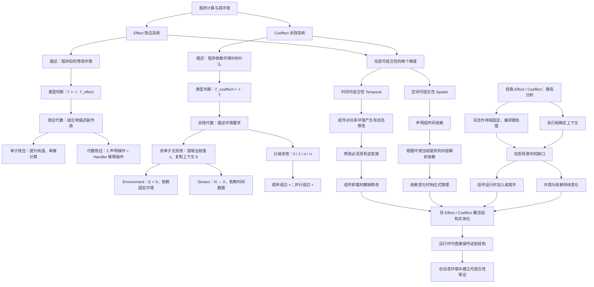

### 阅读要点与术语对照

| 英文术语               | 本文译法     | 在这两页中的含义                               |
| ---------------------- | ------------ | ---------------------------------------------- |
| Effect                 | 效应         | 计算对环境造成的修改或副作用                   |
| Coeffect               | 余效         | 计算对环境提出的依赖或要求                     |
| Effect system          | 效应系统     | 在类型侧描述计算可能产生的副作用               |
| Coeffect system        | 余效系统     | 在上下文侧描述计算需要环境提供什么             |
| Monad                  | 单子         | 组织、封装带效应的计算                         |
| Comonad                | 余单子       | 组织依赖上下文的计算                           |
| Effect handler         | 效应处理器   | 为代数效应操作提供解释                         |
| Temporal composability | 时间可组合性 | 组件卸载时能撤销其环境修改                     |
| Spatial composability  | 空间可组合性 | 组件依赖可声明并随环境变化而管理               |
| Reify / Reification    | 实体化       | 将抽象概念结构变成运行时可直接操作的对象或结构 |

## 3. 可撤销效应与响应式余效的总结

---

### 3.1 全章主旨与逻辑总览

传统 Effect 系统描述“计算对环境做了什么”，传统 Coeffect 系统描述“计算需要环境提供什么”。作者把这两个概念从静态类型分析提升为运行时机制：

- **Revertible Effects（可撤销效应）**：每次改变上下文时，同时产生一个能撤回本次改变的逆函数，并由运行时保存。它解决组件卸载时如何撤销自身副作用的问题，对应**时间可组合性**。
- **Reactive Coeffects（响应式余效）**：组件声明自己依赖哪些上下文键；每次上下文变化都根据该声明判断依赖从“不满足”变为“满足”、从“满足”变为“不满足”，还是没有改变。该分类驱动组件激活和停用，对应**空间可组合性**。
- **The Context Paradigm（上下文范式）**：把效应上下文与余效上下文合并成一个统一、递归的上下文，要求组件与环境的交互都经过这个上下文，并限制组件可执行的操作形态。
- **Observational Equivalence（观察等价）**：不要求撤销后物理状态逐字节相同，而要求外部通过该接口能够执行的测试无法区分两种状态。
- **Independence / Commutativity（独立性／交换性）**：保证不同组件的正向修改和逆向撤销互不干扰，并把组件间的独立性归约为共享余效键上的操作是否可交换，以及提供键与使用键是否冲突。

本章的推理链可以概括为：

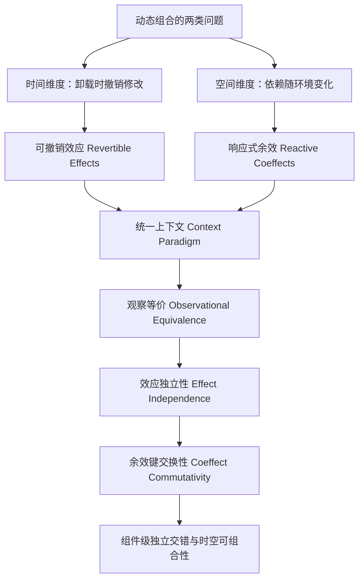

### 3.2 先统一符号

| 符号               | 含义                                                         |
| ------------------ | ------------------------------------------------------------ |
| `Γ`                | 普通上下文类型；可以承载程序共享的状态或环境信息             |
| `γ ∈ Γ`            | 某一时刻的上下文状态                                         |
| `f : Γ → Γ`        | 正向上下文变换，即一个效应                                   |
| `g : Γ → Γ`        | 对应的逆函数；在应用后的状态上撤销正向变换                   |
| `∂Γ = Γ × (Γ → Γ)` | 效应上下文：当前状态加上撤销累积器                           |
| `φ`                | accumulator（累积器），组合到目前为止各次效应的逆函数        |
| `Σ`                | coeffect context（余效上下文），即按键组织的有限、带类型的依赖表 |
| `K`                | 依赖键的集合                                                 |
| `V_k`              | 键 `k` 对应的值类型；不同键可以有不同类型                    |
| `d ⊆ K`            | 一个组件声明的依赖键集合，即 coeffect specification          |
| `σ ⊨ d`            | 余效上下文 `σ` 满足依赖声明 `d`：其中所有键都已绑定          |
| `𝔈Γ` / `𝔈Γ*`       | 效应函数类型／带“逆函数确实撤销本次变换”见证的效应函数类型   |
| `ℑΓ` / `ℑΓ*`       | 效应迭代器／带见证的效应迭代器                               |
| `≃`                | 由可观察操作定义的观察等价，不必等于物理状态相等             |
| `𝔐(i)`             | 迭代器 `i` 的变换生成子幺半群，包含它可执行的正向变换和所产生的逆变换 |

文中的复合记号 `f ∘ g` 按通常函数复合读取：先执行右边的 `g`，再执行左边的 `f`。这点尤其影响逆函数的累积顺序。

---

### 3.3 Revertible Effects：可撤销效应（pp. 9–16）

#### 论文3.1节的目标

组件运行时会修改共享环境。若组件可以动态卸载，系统就必须知道它改过什么，并能把这些修改撤销。作者因此把一个效应建模为：输入当前上下文，返回新上下文和一个明确的逆函数：

$$
 e : \Gamma \to \Gamma \times (\Gamma \to \Gamma)
$$

若 `e(γ) = (δ, g)`，则 `δ` 是修改后的上下文，`g` 是本次效应的逆函数，要求：

$$
 g(\delta)=\gamma
$$

也就是说，逆函数的正确性针对**这次实际应用所产生的新状态**来保证，而不是仅仅声称存在一个抽象的“撤销操作”。运行时把逆函数保存起来，才有条件在卸载时执行恢复。

#### Effect Context：把撤销信息放进上下文

1. **把副作用显式化为上下文变换**

作者先把不纯函数写成显式接收和返回上下文的纯函数：

$$
f : X \rightsquigarrow Y
 \quad\leadsto\quad
 f : \Gamma \times X \to \Gamma \times Y
$$

固定输入 `x` 后，函数对 `Γ` 的第一投影就是上下文变换。于是副作用可以统一看作 `Γ → Γ` 上的函数复合。

这些变换在复合下形成幺半群：复合封闭、满足结合律，并以恒等函数为单位元。这个代数结构让“多个效应连续发生”可以按组合规则推理。

2. **正向变换与逆变换采用扭曲复合**

作者把效应与其逆函数配成一对 `(f,g)`。对于两次连续发生的效应，复合定义为：

$$
 (f_1,g_1)\circ(f_2,g_2)
 = (f_1\circ f_2,\;g_2\circ g_1)
$$

正向变换按发生顺序组合；逆函数则按相反顺序组合。这是因为若先执行 `f₂`、再执行 `f₁`，撤销时必须先撤销 `f₁`，再撤销 `f₂`。作者称这个结构为 **twisted composition monoid（扭曲复合幺半群）**。

这里的“inverse”是单侧的：要求 `g ∘ f` 在相关状态上恢复原状，不要求 `f ∘ g` 也为恒等。它不是一般意义上的双向可逆函数。

3. Effect Context 与 accumulator

定义：

$$
 \partial\Gamma \triangleq \Gamma\times(\Gamma\to\Gamma)
$$

效应上下文由两部分组成：

- `γ`：当前上下文状态；
- `φ`：累积器，保存此前所有效应的逆函数复合。

初始状态写作 `(γ₀, idΓ)`。每次发生一个效应 `(f,g)`，通过 `track` 更新：

$$
 \operatorname{track}_\Gamma(f,g)(\gamma,\varphi)
   = (f(\gamma),\;\varphi\circ g)
$$

它同时完成两件事：用 `f` 更新当前状态；把 `g` 追加到累积器。因而运行时并非只留下“新状态”，还保留了未来撤销所需的信息。

4. **`track` 的两个关键性质**

- **定理 4：正向行为不变。** 对效应上下文取第一投影，得到的结果与直接执行 `f` 一样。也就是说，加入追踪机制不会改变程序原有的正向状态变换。
- **定理 5：`track` 保持扭曲复合。** 先分别追踪多个效应，再复合，与先复合效应对、再一次性追踪相同。换言之，追踪与效应组合相容。

接着定义恢复：

$$
 \operatorname{recover}_\Gamma(\gamma,\varphi)
   = (\varphi(\gamma), id_\Gamma)
$$

它执行累积器所代表的撤销函数，并将累积器重置成恒等函数。

5. **定理 7：soundness invariant（可靠性不变量）**

若某次效应的逆函数确实满足 `g(f(γ)) = γ`，那么执行该效应前后再调用 `recover`，结果相同：

$$
 \operatorname{recover}(\operatorname{track}(f,g)(\gamma,\varphi))
 = \operatorname{recover}(\gamma,\varphi)
$$

作者把：

$$
 \varphi(\gamma)=\gamma_0
$$

称为可靠性不变量。直观地说，当前上下文虽然已经经过很多修改，但“把累积器执行一遍之后应回到的目标状态”始终不变。因为 `track` 保持这个量，多个效应可以串联；只要每个逆函数都撤销自己的那一步，整串效应也能通过组合逆函数恢复。

#### Effect Functions：从固定逆函数到逐状态返回逆函数

前面的 `track/recover` 方案有两个限制：

1. `(f,g)` 的 `g` 是预先固定的，必须对所有可能状态都有效。但很多操作只能在执行时、看到实际状态后，才能构造恰好适用于本次状态的逆函数。
2. `recover` 一次性执行整个累积器，不能单独撤销某一个效应而保留其他效应。

作者据此把“产生新状态”和“返回逆函数”绑定在一次函数调用中：

$$
 \mathcal{E}_\Gamma \triangleq
 \Gamma\to\Gamma\times(\Gamma\to\Gamma)
$$

并进一步定义带见证的效应函数 `𝔈Γ*`。它除了给出 `e`，还携带证明：当 `e(γ)=(δ,g)` 时，`g(δ)=γ`。因此逆函数可以随输入状态变化，每一次调用都提供自己的撤销证据。

**效应复合 `⋄`**

因为效应函数的返回值不再只是上下文状态，而是“状态 + 逆函数”，不能直接当作普通 `Γ → Γ` 端函数来复合。作者定义新的复合 `f ⋄ g`：先执行右操作 `g`，再执行左操作 `f`，并把两个逆函数按撤销所需的相反顺序合成。

**定理 10**：`(𝔈Γ, ⋄)` 形成幺半群，单位元是返回原状态及恒等逆函数的函数；从固定函数对 `(f,g)` 到状态依赖效应函数的嵌入保持幺半群结构。

**定理 11**：带见证的效应函数在 `⋄` 下封闭，因而一连串各自具有正确逆函数的效应，组合后仍然具有正确逆函数。若某个固定 `g` 满足 `g ∘ f = idΓ`，它当然也能作为每个状态上的见证。

**`effectΓ`：把效应提升到效应上下文**

作者再定义 `effectΓ`，把普通上下文上的效应函数提升到效应上下文 `∂Γ` 上。提升后的效应不仅更新 `γ`，还更新累积器；它返回的逆函数也会被追踪，使“撤销这次效应”本身仍是一项能够按同一框架追踪的操作。

- **定理 13**：`effectΓ` 保持效应复合 `⋄`。
- **定理 14**：提升前后的正向映射和逆映射，与上下文投影相容；在外层看见的状态行为仍对应原来的变换。
- **定理 15**：提升后的逆函数总能恢复这次效应之前的状态，并保持可靠性不变量。但要让提升后的逆函数把整个累积器也精确恢复成原值，要求更强的全局条件 `g ∘ f = idΓ`。因此，**逐状态可撤销**与**在所有状态上统一可逆**不是同一要求。

#### Effect Iterators：把一串效应组织成迭代器

组件加载通常不是执行一个效应，而是执行一系列效应；卸载则要撤销整串操作。

**定理 16**：若各个带见证的效应按顺序应用，并按应用顺序的逆序撤销，那么：

1. 每个逆函数都会遇到它创建时所对应的状态，因此能准确恢复该步之前的状态；
2. 每个中间状态都维持可靠性不变量。

为了把一串效应本身作为一等结构，作者定义 **effect iterator（效应迭代器）**。每次迭代返回三元组：

- `δ`：新上下文；
- `g`：本次效应的逆函数；
- `o`：后续控制信息。`Nothing` 表示结束；`Just(i)` 表示继续执行下一轮迭代 `i`。

带见证迭代器要求每一轮的逆函数都能撤销该轮变换；而后续迭代本身也保持同一见证结构。

`effectiterΓ` 递归地把迭代器提升到效应上下文：每一轮都将逆函数追加到累积器，形成按 **LIFO（后进先出）** 顺序撤销的组合。迭代器因此可被看成“一个整体的效应”，能在需要效应函数的地方使用。

作者特别指出，迭代器的 continuation 提供了两个效应步骤之间的边界；这个结构类似语言中的 `yield` 所暴露的分段延续（delimited continuation）。单个效应函数则是只有一轮、立即终止的退化迭代器。

#### 论文3.1节小结：局部时间可组合性

对单个组件而言，只要它的每个效应都返回经过见证的逆函数，加载就是执行迭代器并累积逆函数；卸载就是执行累积器。于是组件的整串修改可以被恢复，且单组件内的撤销顺序由累积器强制为 LIFO。

但 3.1 尚未解决两个多组件问题：

- 当组件 A 的逆函数执行时，其他组件的效应可能仍然存在，当前状态已不是 A 当初执行时的状态；
- 多个组件的效应可能交错执行，A 的若干步骤可能被 B 的步骤隔开。

要使这些情况下的逆函数仍然只撤销自己的贡献，需要第 3.4 节的独立性条件。

---

### 3.4 Reactive Coeffects：响应式余效（pp. 16–20）

#### 论文3.2节的目标

空间可组合性关注组件之间的依赖。组件不仅需要声明依赖，还需要在依赖出现或消失时自动改变生命周期状态：全部依赖到齐才激活；某个必需依赖消失时停用。作者把“组件需要什么”表示成 coeffect specification，并把每次上下文变化分类为激活、停用或中性。

#### Coeffect Context：带类型的依赖表

令 `K` 是键集合，每个键 `k` 对应值类型 `V_k`。余效上下文定义为有限的依赖部分函数：

$$
 \Sigma \triangleq (k:K)\rightharpoonup V_k
$$

也就是说，`σ` 是一个有限键值表，但不是所有键都必须存在；每个键的值类型由键决定。

基本操作：

- `get(k)`：读取键 `k` 的值，前提是 `k` 已绑定；
- `set(k,v)`：安装键 `k` 的值，前提是 `k` 尚未绑定。它返回新表及逆函数；逆函数会移除该键，即 restriction（限制表）。

这两个前提很重要：本节的 `set` 是“注册一个尚不存在的依赖键”，而非任意覆盖已有值；撤销也只对已经存在的键有效。若违反前提，操作报错且不发生状态迁移。作者也提到可以把部分函数失败显式封装进 `Maybe`，但那不是本节主线。

关键联系：`set(k,v)` 本身就是一个带见证的效应函数。因此，余效表的注册和撤销可以直接复用 3.1 的效应追踪、累积和恢复机制。换言之，依赖提供并非绕开效应系统的特殊操作，而是被建模成可撤销的环境修改。

#### Specification and Notification：满足性与变化通知

**1. 满足性**

对依赖声明 `d ⊆ K`，定义：

$$
 \sigma\models d
 \quad\triangleq\quad
 \forall k\in d,\;k\in\operatorname{dom}(\sigma)
$$

意思是：组件声明的所有依赖键，都已经在当前余效上下文中注册。由于 `σ` 是有限部分函数，这个判断是可判定的。

组件规范定义为键集合：

$$
\mathbb{D}_\Sigma\triangleq\operatorname{Set}(K)
$$

**2. 对每次上下文变化分类**

给定变更前状态 `σ`、变更后状态 `σ'` 和规范 `d`，定义通知函数 `notify_d(σ,σ')`：

| 变更前     | 变更后     | 分类           | 语义                                   |
| ---------- | ---------- | -------------- | -------------------------------------- |
| 不满足 `d` | 满足 `d`   | `activating`   | 依赖刚刚全部到齐，可以激活组件         |
| 满足 `d`   | 不满足 `d` | `deactivating` | 至少一个依赖丢失，必须停用组件         |
| 其他情况   | 其他情况   | `neutral`      | 满足性没有发生转换，不触发生命周期切换 |

激活会执行组件自己的效应迭代器，并按 3.1 追踪逆函数；停用会执行累积器，撤回组件的效应。中性变化则不要求改变组件激活状态。

**3. 这一层保证了什么，又没保证什么**

对单个组件，局部空间可组合性要求：

- 组件只在依赖规范被满足时激活，所以不会在激活过程中读取一个缺失的依赖；
- 每次余效上下文变化都会被分类，因此依赖丢失会在发生时被检测，并触发停用。

但多组件场景还有两个时序问题，本节明确留给第 4 章的全局理论处理：

1. 一个提供者撤回绑定之前，必须等所有因此需要停用的依赖者完成停用；
2. 依赖者正在激活、读取其所需绑定时，这些绑定必须保持不变。

这说明 `notify` 已解决“检测到变化并决定方向”，但组件之间的生命周期协调仍需全局规则。

#### Isolation and Interception：隔离与拦截

基础 `Σ` 是一张扁平依赖表。实际系统可能需要：同一个逻辑键在不同组件上下文中对应不同值；或者在依赖访问时附带横切元数据。作者引入两种机制。

**A. 两种效应实现方式：in-place 与 derived**

作者强调，效应的抽象语义是“后继状态 + 逆函数”，但实现方式可不同：

- **In-place realization（原地实现）**：直接修改原上下文，后继状态与输入上下文别名；返回非平凡逆函数，恢复时运行逆函数撤销修改。
- **Derived realization（派生实现）**：不修改输入上下文，而创建一个从输入派生的新上下文；逆函数是恒等函数，恢复通过丢弃派生上下文实现。

在纯函数语境下两者可视为一致；命令式宿主环境可按操作选择。隔离和拦截采用派生式实现：它们改变某个上下文视图如何解释依赖，但不修改共享依赖表本身，因此无需为这项派生创建追踪逆函数。

**B. Coeffect Isolation：隔离域**

带隔离的余效上下文包含两张表：

$$
 \Sigma_{iso}\triangleq(K\rightharpoonup R)\times((r:R)\rightharpoonup V_r)
$$

- `ρ`：逻辑键到隔离域（realm）的映射；
- `σ`：隔离域到实际值的依赖表。

访问逻辑键 `k` 时，先用 `ρ(k)` 找到隔离域 `r`，再读取 `σ(r)`。若某个键没有显式隔离映射，则默认映射到自身。

`isolate(k,r)` 会派生一个新上下文，把 `k` 指向新的 realm `r`，但不改动底层依赖值表。这样相同键在不同派生上下文中可以解析到不同值，支持多租户、测试环境和组件沙箱等场景。`set` 仍然是对实际值表的可撤销效应；`isolate` 本身则只是派生上下文。

**C. Coeffect Interception：访问拦截与元数据**

拦截机制允许依赖的使用携带元数据，元数据可以来自两个地方：

- 上下文携带的元数据 `ι(k)`；
- 组件声明的元数据 `d(k)`。

每个键的元数据有自己的合并幺半群 `(M_k, ⊕_k, ε_k)`。余效上下文保存元数据和 provider 函数；组件规范则把各个键映射到组件所声明的元数据。

组件访问 `k` 时，实际计算：

$$
 \sigma(k)\big(d(k)\oplus_k\iota(k)\big)
$$

即先合并组件元数据与上下文元数据，再把合并结果交给 provider 函数以获得依赖值。合并规则由键自己定义，例如标量字段覆盖、集合字段取并集。论文规定合并是右偏的，因此上下文的 `ι(k)` 优先，可以覆盖组件自己的声明；外围上下文由此能约束内部组件如何使用依赖，而不必修改组件本身。

---

### 3.5 The Context Paradigm：上下文范式（pp. 21–25）

#### 论文3.3节的目标

3.1 的效应上下文携带“当前状态 + 撤销累积器”；3.2 的余效上下文携带“依赖键及其值”。若两者分开，组件仍可能通过不同通道与环境交互。上下文范式把它们整合进一个统一上下文，并要求组件的每个执行步骤都是在这个上下文上进行的受约束操作。

#### Unified Context：统一上下文与受约束操作

**1. 统一上下文的递归类型**

作者定义：

$$
 \Gamma_\infty\triangleq\mu\Gamma.\;\Gamma\times(\Gamma\to\Gamma)\times\Sigma
$$

三个投影分别是：

1. `Γ`：当前的递归上下文状态；
2. `Γ → Γ`：当前层级的累积器，负责撤销该层的效应；
3. `Σ`：携带依赖信息的余效上下文。

递归结构把前一层上下文及其累积器作为更高层状态的一部分；因此原本逐层递归的效应上下文塔可以由同一种自相似类型表示。

由于 `V_k` 的类型族没有被限制为某个狭窄类型集合，系统中需要在组件间共享的任何状态原则上都可以通过某个键绑定进 `Σ`。作者因此把 `Σ` 看成对共享可变状态的统一承载体，而不只是依赖注入表。组件与环境的交互都要经过这个实体。

**2. 每个键不只定义值类型，还定义可用操作**

作者定义一个键上的 coeffect 为：

$$
 (V_k,A_k)
$$

其中 `V_k` 是键绑定值的类型，`A_k` 是这个值向持有该键的组件公开的一组操作。

一个操作 `a ∈ A_k` 有参数类型 `X_a` 和结果类型 `B_a`，对键值执行状态变换并返回：

- 新的键值；
- 本次键值变换的逆函数；
- 一个可观察结果（outcome）。

形式上：

$$
 a:X_a\to V_k\rightharpoonup
 V_k\times(V_k\rightharpoonup V_k)\times B_a
$$

这个操作随后被提升到整个余效上下文 `Σ` 上：它只读取和写回键 `k` 的绑定，其他键保持不变。这样“操作属于哪个键”在类型和定义上都被明确限定。若一个操作行为依赖另一个键，该键的值应作为操作参数显式传入；相应绑定在依赖者运行期间如何保持稳定，则由响应式依赖纪律和后续全局定理保证。

**3. Context-mediated iterator：组件可执行的阶段形态**

作者定义了受上下文范式约束的迭代器。其关键参数是两个键集合：

- `S`：组件会在其上执行操作、因而会读取／使用的键集合；
- `P`：组件可能提供（provision）的键集合，且 `P ⊆ S`。

每轮迭代只能是以下两类阶段之一：

**操作阶段（operation stage）**：在 `k ∈ S` 上执行该键公开的某个操作。操作结果 `b` 决定接下来选择哪个 continuation，因此后续步骤可以依赖此前操作的 outcome。

**提供阶段（provision stage）**：在 `k ∈ P` 上执行 `set(k,v)`，安装一个绑定，并获得移除该绑定的逆操作。由于 `set` 的前提要求键原本不存在，且该阶段有自己的逆函数，提供键的安装与撤回同样被纳入效应追踪。

本节强调，这种阶段形态正是“所有交互都经由统一上下文”的形式化内容。若一段代码读取一个未通过键绑定的隐藏位置，或者通过外部计数器分配句柄却不把计数器纳入上下文，那么它不符合这一纪律。把计数器也绑定为一个键，才可以把该类状态纳入框架。

**4. 层级式组合**

递归上下文支持父子层次：父上下文可以聚合并管理多个子上下文的效应；不同层级的组件能够独立加载和卸载。加载相当于“插入”组件效应，卸载相当于“拔出”并撤销它们。父级累积器可以管理子级效应，从而支持嵌套组合。

#### Observational Equivalence：从物理相等改为可观察相等

**1. 为什么不能要求字面状态完全复原**

3.1 的恢复保证若按物理表示的完全相等理解，会过于理想化。例如：

- `free` 可以把一块内存交还给分配器，但通常不会把堆的布局恢复成此前 `malloc` 之前的样子；
- 生成式名称／句柄被撤销后，后续重新创建可能分配新的名字，而不是复用原来的名字。

因此，作者把本章的等式改为相对于某种观察能力的等价：两个状态若没有任何允许的观察者能够区分，就可视为等价。

**2. 通过测试定义键值的可区分性**

一个值的观察者能够执行该键公开的操作，并读取操作产生的 outcomes。作者把一个测试定义为有限操作序列，序列中的字母可以是各操作的正向映射或其返回的逆函数。

两个值 `v` 和 `v'` 在某键操作集合 `A` 下不可区分，当且仅当：

- 对每个测试，若测试在一个值上有定义，则在另一个值上也有定义；反之亦然；
- 测试在两个值上产生的可观察 outcomes 完全相同。

每个键的等价关系 `≃_k` 就是该键自身操作所诱导的不可区分关系。

**引理 32** 给出两点：

- `≃_k` 是等价关系，而且该键的每个操作都尊重它（在相关值上保持定义性、后继值、逆函数所到达的值与 outcomes 的关系）；
- `≃_k` 是满足上述尊重条件的最粗等价关系。也就是说，若希望某个等价关系被该键的所有操作保持，它就不能比 `≃_k` 更细地保留额外的、接口无法观察的信息。

**3. 从单键等价组合成上下文等价**

给定键集合 `S`，两个余效上下文在 `S` 上等价，需要：

- 它们在 `S` 中绑定的键集合一致；
- 每个共同绑定的键，其值按相应 `≃_k` 等价。

两个完整状态的 `≃_S` 关系，则通过比较它们的余效投影得到。若 `S=K`，可省略下标；较小的 `S` 会进一步忽略不属于该组件声明范围的键。

这个设计允许组件只对自己声明／使用的键负责。与任何键都无关、也不经由键访问的物理细节不会自动成为比较对象；相应地，一个组件的性质只需在它相关的键集合上建立。

**4. 把等价关系提升到函数、产品和迭代器**

论文继续把 `≃_S` 从状态和值扩展到：

- 函数：相关输入必须产生相关输出；
- 元组／积类型：逐分量相关；
- `Maybe`：两个值都为 `Nothing`，或都为 `Just` 且内容相关；
- 递归类型和迭代器：按递归展开的最大关系（coinductive relation）比较。

一个函数“尊重” `≃_S`，意思是它能在商空间 `Γ/≃_S` 上有良好定义。需要注意：函数关系的自反性并非自动成立，函数若依赖 `S` 外部的状态分支，可能尊重全局关系却不尊重某个限制较严格的 `≃_S`，反之也可能出现不同结果；因此尊重哪一组键是实际条件。

**5. 把可撤销见证改成观察等价意义下的见证**

**定义 36、37** 将“逆函数恢复原状态”的字面等式，改成“逆函数恢复一个观察等价的状态”，并要求效应函数／迭代器本身尊重该等价关系。

**引理 38** 说明：在此设置下，3.1 的恢复论证仍然成立，只需把状态相等 `=` 换成观察等价 `≃`；从初始状态可达的累积器也尊重等价关系。证明所需的核心性质是等价关系的传递性，以及逆函数对该关系的尊重。

**引理 39** 进一步说明：若一个上下文介导迭代器所有阶段触及的键都包含在 `S` 中，那么该迭代器及其逆函数都尊重 `≃_S`，而每一步的逆函数见证仍可在实际应用的相等状态处成立。

#### 论文3.3节 小结：上下文范式的意义

统一上下文规定了“状态在哪里”“逆函数在哪里保存”“依赖在哪里注册”“操作通过什么接口发生”。观察等价则把撤销正确性的目标，从不现实的物理快照复原，调整为 API 可观察行为不变。两者共同为后续跨组件的独立性证明提供基础。

---

### 3.5 Attaining Independence：获得独立性（pp. 26–30）

#### 论文3.4节的目标

前面得到的是“单个组件自己的效应可以撤销”“单个组件的依赖变化可以被识别”。但多个组件运行时，A 的逆函数可能在 B 的效应已发生之后执行；不同组件的效应也可能交错。因此必须给出条件，使得一个组件的变换不破坏另一个组件的逆函数和控制流程。

本节分两步：

1. 先给出一般的 **effect independence（效应独立性）**；
2. 再利用“效应只能读写特定余效键”的结构，把一般独立性转化为键级别的 **coeffect commutativity（余效交换性）**。

#### Effect Independence：效应独立性

**1. 为什么仅有 LIFO 累积器不够**

定理 16 已经保证：若一个组件在自己的效应序列完成后按 LIFO 撤销，逆函数会遇到各自预期的状态。但在以下情况下，逆函数可能面对被其他效应修改过的状态：

- 卸载一个仍在运行系统中的组件，其他组件的效应仍然存在；
- 多个组件交错执行，各组件的效应步骤之间穿插着别的组件的步骤。

因此需要更强的条件：组件 A 能执行的每一种变换，都必须与组件 B 能执行的每一种变换相容；这里既包括正向变换，也包括任何状态下可能返回的逆变换。

**2. 变换生成子幺半群**

对迭代器 `i`：

- `reach(i)` 是从 `i` 出发，沿 continuation 可到达的全部后续迭代器；
- `𝔐(i)` 是由 `reach(i)` 中所有迭代阶段的正向变换，以及这些阶段在各个上下文状态下返回的逆变换生成的子幺半群。

因此 `𝔐(i)` 不是“当前这一轮的函数集合”，而是整个迭代器所有可达步骤可能执行的变换闭包。

**引理 41**：

- 若两个生成集合中的每个生成元彼此交换，那么它们生成的整个两个子幺半群也彼此交换；
- 两个效应函数通过 `⋄` 组合后，并不会创造出超出原有生成变换联合生成范围的新变换。

这让独立性检查可以落在生成元上，而不必逐一枚举无限复合。

**3. 迭代器独立性的两个条件**

**定义 42**：两个迭代器 `i`、`j` 独立，需要同时满足：

**条件一：变换两两交换。**

$$
 \forall f\in\mathfrak M(i),\;g\in\mathfrak M(j),\quad
 f\circ g=g\circ f
$$

即 A 的任一正向或逆向变换，与 B 的任一正向或逆向变换都可交换。

**条件二：对方不能改变自己将要产出的结果。**

对 `i` 的任一可达阶段 `i'`，若先用 `j` 的某个变换 `g` 改变输入状态，再观察 `i'` 的返回值，则其逆函数和 continuation 必须与不先执行 `g` 时相同；`j` 对 `i` 的对称条件也必须成立。

为什么还要条件二？仅仅保证状态变换可交换还不够。迭代器不仅返回状态和逆函数，还会返回下一轮 continuation；如果对方的变换改变了本轮产生的逆函数或下一步控制流程，两个组件仍可能互相干扰。对普通单步效应函数而言没有后续 continuation，这个条件相应简化为：对方变换不能改变本次效应所返回的逆函数。

论文也提醒，独立性不等于 `e₁ ⋄ e₂ = e₂ ⋄ e₁` 这样一个整体等式。整体复合相等只比较两种顺序的复合正向函数与复合逆函数；独立性更强，它要求任意一个效应的每个正向／逆向变换都与另一个效应的每个变换相容，并保护对方产出的逆函数与 continuation。

4. **定理 43：独立效应的逆函数可任意顺序执行**

若 `e₁,…,eₙ` 两两独立，并从初始状态依次应用，那么它们各自返回的逆函数，即使在所有正向效应都已经应用之后，也可以按 `{1,…,n}` 的任意排列顺序执行，最终仍回到初始状态 `γ₀`。

直观理解：独立性允许把某个组件的逆函数“穿过”其他组件的正向变换，而不改变其撤销效果；同时条件二保证其他效应所返回的逆函数及 continuation 不会因此变样。于是整体撤销顺序不必由单一全局 LIFO 栈固定，可按系统调度选择。

这一点正是多个组件运行时能够独立卸载的核心数学条件。第 4 章会把这个结论提升到整个系统的执行轨迹：一个效应与它的撤销之间可以插入其他 fiber 的步骤。

#### Coeffect Commutativity：余效交换性

**1. 从一般独立性下沉到单个键**

在上下文范式中，一个操作只读写它所属的键。不同键的操作天然相互隔离；真正困难的是**同一个键上**的多种操作是否可交换。

由于 3.3 已经引入观察等价，独立性中的相等也按 `≃` 理解。两个操作即使改变了内部表示，只要所有该键允许的观察测试都无法区分，也可以视为交换。

**2. 操作独立与键交换性**

两个操作 `a`、`a'` 独立，需要：

- 它们提升到余效上下文之后，作为效应函数在任意对应参数下满足定义 42 的独立性；
- 一个操作的变换不能改变另一个操作产出的 outcome；反向也成立。

第二点之所以单独写出，是因为键操作比普通效应函数多一个 outcome。即使最终键状态在观察等价意义下相同，若返回的业务结果不同（例如分配 API 返回不同且可观察的句柄），调用者仍可区分两种执行顺序。

当一个键 `k` 的操作集合 `A_k` 中任意两种操作都独立，并且每个操作也与自身独立时，作者称该键为 **commutative（交换的）**。本节后续默认每个 coeffect 都带有这样的交换性见证。

3. **定理 45：不同键的操作自动独立**

如果两个操作分别属于不同键 `k` 和 `k'`，且 `k ≠ k'`，则它们独立。原因是每个操作的 lift 只读取和写入自己的绑定：不同键之间彼此不读写对方的值，因此对应的变换自然交换；一个键上的变换也不会改变另一个键操作所返回的逆函数或 outcome。

因此，操作独立性的实质性约束集中在同一个键内部。

**4. 定义 46：把交换性作为 coeffect 的见证**

一个键上的 coeffect 不再只有 `(V_k,A_k)` 两项，而是再增加一项证明：键 `k` 的操作集合 `A_k` 是交换的。

这与效应函数携带逆函数正确性的证明平行：

- 效应提供者在定义效应时提供“返回的逆函数确实可撤销”的见证；
- 余效键的提供者在定义键时提供“该键上的操作确实交换”的见证。

这样，使用者无需自行猜测或假设某个键是否可交换；性质由提供该键的组件负责证明。由于定理 45 已经证明不同键自然独立，提供者只需证明本键内部的操作交换。

**5. 论文给出的设计案例**

| 场景                                            | 是否交换                 | 原因                                                         |
| ----------------------------------------------- | ------------------------ | ------------------------------------------------------------ |
| 路由注册、事件监听器注册                        | 通常可以                 | 每次注册创建独立条目／唯一标识，逆操作只移除自己创建的条目；不同顺序得到的可观察表行为相同 |
| 带唯一 tag 的集合新增／删除（类似 CRDT 的设计） | 可以满足                 | 每次添加有独立身份，撤销针对自己的 tag，不会误删其他添加     |
| 只按裸元素执行 add/remove 的集合接口            | 不一定                   | 若无法区分多个来源的添加，撤销可能影响其他操作的贡献         |
| 有序 middleware 链                              | 不可交换                 | 插入先后影响请求经过中间件的顺序；移除一个中间件也可能改变其他中间件观察到的请求 |
| 内部句柄可重命名且接口不暴露具体名称的分配器    | 可以在相应观察等价下交换 | 不同分配次序产生的堆状态可通过句柄重命名视为等价             |
| 结果必须按数值相等比较的地址／描述符分配        | 可能不交换               | 后续调用可观察到具体分配结果或顺序；例如 POSIX `open` 要求返回最低可用文件描述符，而 `mmap` 与 `creat` 可选择任意未使用地址／inode，接口约束不同 |

这说明交换性不只是内部数据结构的数学属性，也取决于 API 向使用者公开什么。接口公开越少、观察测试越少，观察等价越粗；若调用者并不需要某个结果，隐藏该结果可能使原本可区分的执行顺序变得不可区分，从而满足交换性。论文把这一思路与 scalable commutativity rule 联系起来。

**6. 定理 47：从键属性推出组件迭代器独立**

定理 47 给出本章收束用的组件级条件。令两个上下文介导迭代器分别使用键集合 `S₁`、`S₂`，提供键集合 `P₁`、`P₂`。若：

$$
 P_1\cap S_2=\varnothing
 \quad\text{且}\quad
 P_2\cap S_1=\varnothing
$$

并且两个迭代器共同操作的每个键都是交换的，那么两个迭代器独立。

这里两个集合分别表达：组件 A 提供的键不能是组件 B 正在使用的键；组件 B 提供的键也不能是组件 A 正在使用的键。若一个键只由一方操作，键局部性已经足以保证独立；若双方都对同一键执行操作，就依赖该键的交换性见证。

定理 47 的推理可以拆成两部分：

- 每个阶段的变换都是 key-local（只针对一个键读写）。不同键的阶段自然交换；同键阶段由该键的交换性见证保证交换。提供阶段与另一组件的使用键不冲突，则它也与对方的阶段独立。
- 对方变换不能改变本方阶段的返回逆函数和 continuation：若对方不操作该键，键值不变；若对方也操作该键，则用该键上的操作独立性保证逆函数和 outcome 不变。相同 outcome 选择相同 continuation。

由于每个 coeffect 都已经携带键交换性见证，系统检查两个组件的声明即可；真正要检查的剩余条件就是两组集合的交集是否为空。

#### 收束：可交换部分与顺序敏感部分分工

作者最后把整个理论分成两种性质：

- **可交换部分由 effects 承担**：组件自身执行效应时可以按任务所需的顺序执行；若效应独立，系统也可以按任意便利顺序撤销它们，不需要不同组件彼此约束。
- **顺序敏感部分由 coeffects 承担**：某个键上的操作若不可交换，顺序必须由效应之外的机制约束。组件内部由累积器按 LIFO 约束撤销；组件之间则由依赖声明约束，提供依赖的组件必须先于依赖者满足要求，撤销绑定则必须等待依赖者停用完成。

这使可组合性的保证达到**组件粒度**，而不是只停留在单个效应操作粒度。

**边界限制**：整个上下文范式有一个明确纪律——每个共享位置都必须通过某个 coeffect 键表示。如果系统中存在无法被重新化为键、也无法通过统一上下文访问的共享状态，那么它落在本章定理的适用边界之外。换言之，独立性证明依赖的是显式建模，而不是自动捕获所有任意副作用。

---

### 关键原理图（Mermaid）

以下图示是对第 3 章论证结构的整理，均为概念图，不是论文原图的逐像素复刻。

图 1：单个组件的可撤销效应生命周期

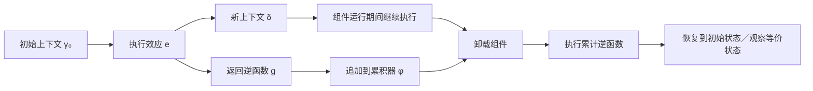

图 2：track、accumulator 与 recover 的关系

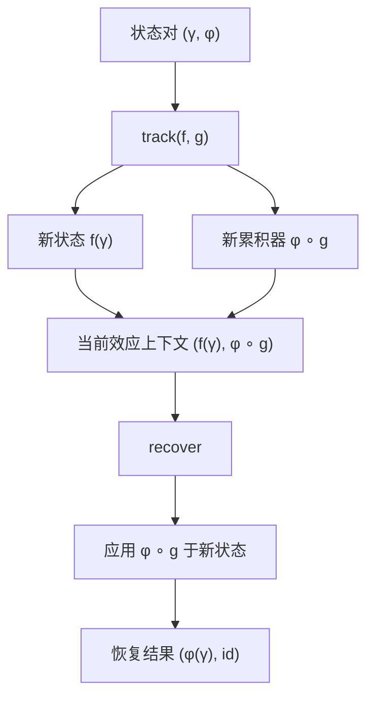

其中，正确逆函数满足 `g(f(γ)) = γ`，因此 `φ(g(f(γ))) = φ(γ)`，即恢复目标不变。

图 3：效应序列的 LIFO 撤销

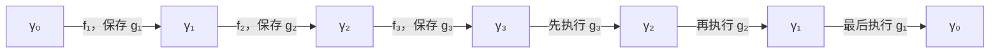

图 4：响应式余效状态机

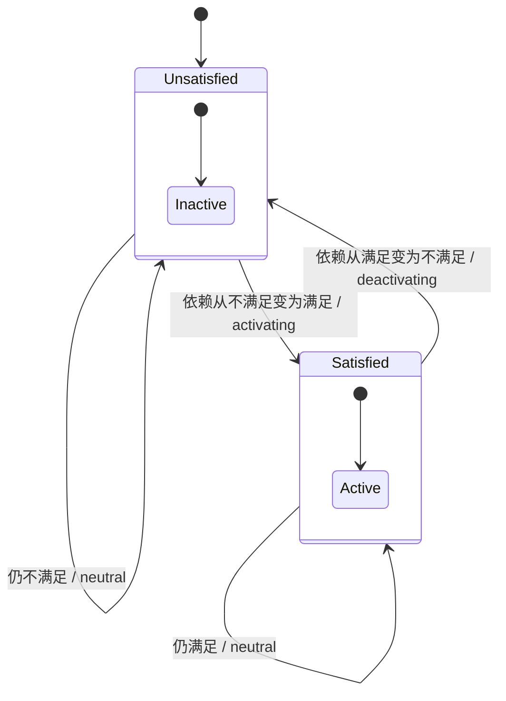

注意：该图表达单组件的满足性变化分类；多个组件之间“何时撤回提供键”以及“激活期间如何保持依赖稳定”的协调属于第 4 章全局语义。

图 5：统一上下文的三层职责

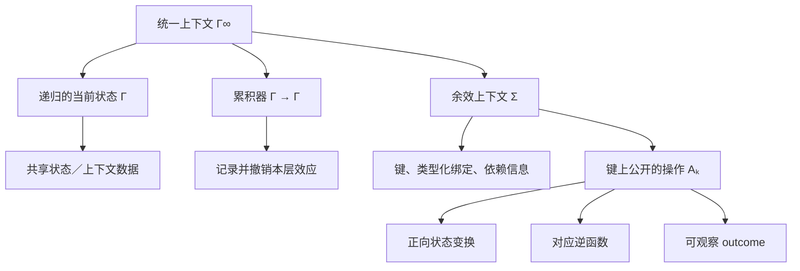

图 6：组件阶段必须经由上下文

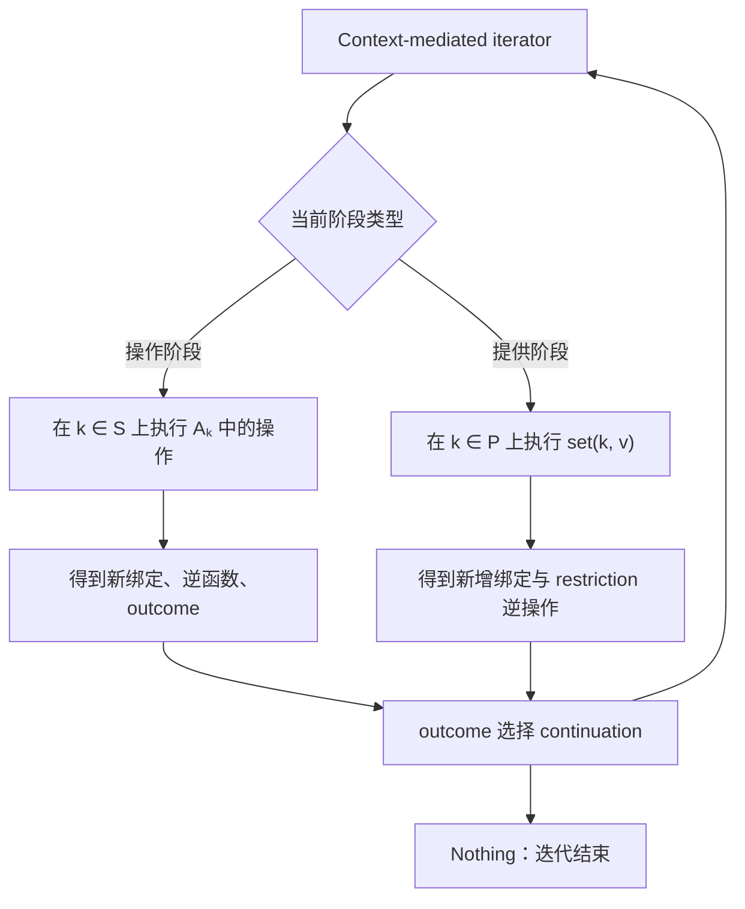

图 7：观察等价的构造

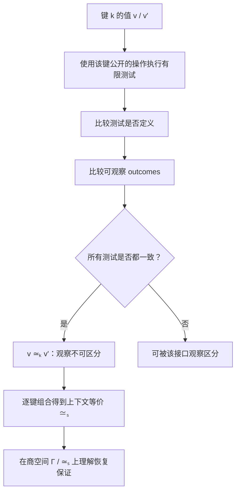

图 8：两个组件何时独立

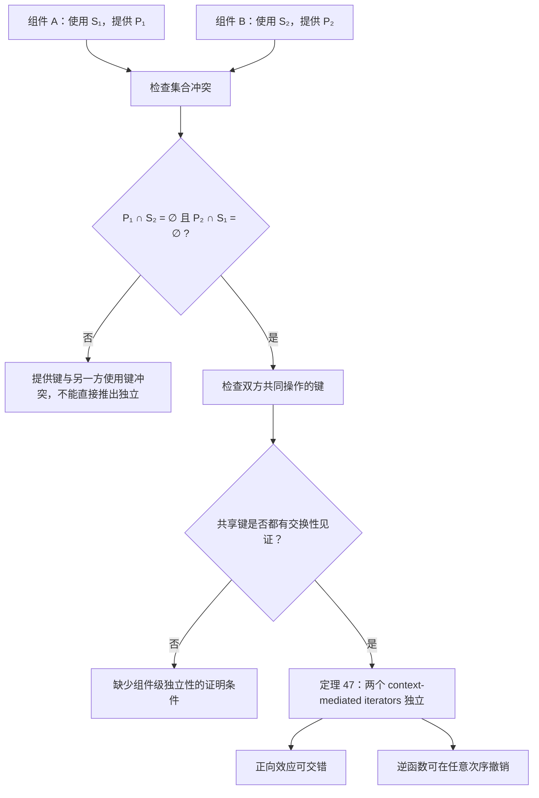

---

### 重要定义、定理与作用速查

| 编号                    | 核心内容                       | 在整章中的作用                           |
| ----------------------- | ------------------------------ | ---------------------------------------- |
| 定义 1                  | 扭曲复合 `(f₁,g₁)∘(f₂,g₂)`     | 让正向效应与逆函数按相反顺序组合         |
| 定义 2–3                | 效应上下文、`track`            | 把逆函数累积在运行时上下文中             |
| 定理 4–5                | 投影保持、`track` 为同态       | 证明追踪不改变正向行为且尊重复合         |
| 定义 6、定理 7          | `recover`、恢复目标不变量      | 建立可撤销的局部正确性                   |
| 定义 8–12               | 带见证效应函数、`⋄`、`effectΓ` | 允许逆函数依赖实际应用状态，并支持提升   |
| 定理 10–15              | 复合封闭、提升性质             | 证明效应函数组合后仍可追踪和撤销         |
| 定理 16、定义 17–18     | LIFO 恢复、效应迭代器          | 把组件的多步加载／卸载建模为一体         |
| 定义 19–20              | 余效上下文、`get` / `set`      | 建立带类型的运行时依赖表，并使注册可撤销 |
| 定义 21–22              | 依赖规范、`notify`             | 把上下文变化分类为激活／停用／中性       |
| 定义 23–27              | 原地／派生实现、隔离、拦截     | 支持上下文局部解析和访问元数据控制       |
| 定义 28–30              | 统一上下文、键操作、介导迭代器 | 约束组件必须通过统一上下文进行共享交互   |
| 定义 31–35、引理 32、35 | 测试、观察等价及其提升         | 定义“外部不可区分”的恢复正确性标准       |
| 定义 36–37、引理 38–39  | 等价意义下的见证               | 将效应和迭代器的保证推广到观察等价       |
| 定义 40–42、引理 41     | 可达迭代器、变换幺半群、独立性 | 给出跨组件变换不互扰的精确条件           |
| 定理 43                 | 独立效应的逆函数可任意排列执行 | 允许组件在其他效应仍存在时撤销自身       |
| 定义 44–46、定理 45     | 操作独立、键交换性及其见证     | 把独立性责任落在键的提供者身上           |
| 定理 47                 | 键条件推出组件迭代器独立       | 得到组件级独立交错的充分条件             |

### 读完第 3 章应记住的五个结论

1. **撤销不是事后补写的清理回调**：逆函数与正向变换在同一次应用中产生，运行时立即记录它，避免创建和清理逻辑分散。
2. **单组件 LIFO 可撤销不自动意味着多组件可任意撤销**：跨组件交错必须额外满足独立性，尤其要保证一个组件的逆函数不会被另一个组件的变换破坏。
3. **依赖是可观察的运行时状态，不是静态配置标签**：系统通过 `σ ⊨ d` 和 `notify_d` 在每次状态转换时检测依赖是否刚刚满足或失效。
4. **接口决定什么叫“相同”以及什么操作可交换**：观察等价取决于键向使用者暴露的操作与 outcomes；隐藏不必要的内部表示或结果，有时可以让操作在观察意义下可交换。
5. **组件独立性有可检查的结构条件**：提供键不与对方使用键冲突；共同使用的键必须由其提供者证明操作交换。若所有共享状态都经键显式建模，局部效应／余效机制才有条件组合成组件级保证。

## 4 A Calculus of Dynamic Composition的总结

> 第4章把第3章的**时空可组合性理论**转化为**动态组合演算**，描述系统如何由多个组件实例构成，以及这些实例如何在任意交错的执行中被插入、激活、停用和移除。
>
> 三个核心对象：
>
> - **Component**：三元组 \((d,p,e)\)，分别声明依赖、提供的 key，以及带 witness 的 effect function。
> - **Fiber**：组件的一次实例化，拥有自己的表、父节点、退休标记和生命周期状态。
> - **Registry**：状态中 fiber name 到 fiber 的有限映射；全局 coeffect context 从 ACTIVE fibers 的表导出。
>
> 两类规则：
>
> - **Orchestration rules（O-）**：orchestrator 主动执行，负责插入、退休、移除。
> - **Lifecycle rules（L-）**：当前提成立时由系统执行，负责激活、迭代、完成、转向和卸载。
>

章节证明顺序：良构性保持、时间可组合性、空间可组合性、进展与终止、合流性，最后讨论四类扩展。

### 4.1 Components and Fibers：组件、fiber 与注册表（31–34页）

#### 组件定义

**定义48**：

$$
\mathcal C_\Gamma \equiv
(d:\mathbb D_\Gamma)\times(p:\mathbb P_\Gamma)\times
\mathcal I_\Gamma^{d\cup p}
$$

组件写作 \((d,p,e)\)：

- \(d\)：coeffect specification，声明组件运行所需的环境依赖。
- \(p\)：coeffect provision，声明组件可能向环境提供的 key 集合。
- \(e\)：带 witness 的 effect function，是一个 effect iterator，描述激活时贡献的效果及撤销它们的逆操作；witness 在 \(d\cup p\) 指定的投影/等价关系下成立。

因此接口有两个方向：\(d\) 是从环境读取的部分，\(p\) 是向环境提供的部分。effect function 不会在 \(p\) 之外安装 binding。

#### Fiber 定义

**定义49**把组件的一次实例化表示为：

$$
\langle d,p,e,\pi,\sigma,\tau,\theta\rangle
$$

- \(d,p,e\)：组件的依赖、提供声明和 effect function。
- \(\pi\)：parent；由哪个 fiber 实例化，或为 `root`。
- \(\sigma\)：fiber 自己的 coeffect table，初始为空，由自身 effect stages 写入。
- \(\tau\)：retirement flag；新 fiber 为 \(\bot\)，退休后为 \(\top\)。
- \(\theta\)：生命周期状态。

四种生命周期状态：

- `INACTIVE`：未安装，不贡献 coeffect。
- `RELOADING(i,g,ω)`：正在激活；\(i\) 为剩余 iterator，\(g\) 为已累积的逆操作，\(\omega\) 为提交时的依赖解析视图。
- `ACTIVE(g,ω)`：激活完成，效果已安装。
- `UNLOADING(g,ω)`：正在停用，等待依赖者退出后应用逆操作。

fiber 只要不处于 `INACTIVE` 就是 installed；因此 `RELOADING` 和 `UNLOADING` 也属于 installed，但这不代表它们的表会对全局公开。

#### Registry 与 coeffect context

**定义50**：状态 \(\gamma\) 携带有限偏函数 \(F_\gamma:\mathbb N\rightharpoonup\mathcal F_\Gamma\)，将 fiber name 映射到 fiber。parent 指针形成以 `root` 为根的树。name 为 fiber 提供稳定身份，即使其生命周期字段变化，其他 fiber 仍可通过 name 引用它。

全局 coeffect context：

$$
\sigma_\gamma =
\bigcup\{\sigma_m\mid m\in dom(F_\gamma),\theta_m=ACTIVE(-,-)\}
$$

只有 `ACTIVE` fiber 的表被合并进全局 context。`RELOADING` 和 `UNLOADING` fiber 的表即使已有 binding，也暂不对其他组件公开。

基础演算采用**单一提供者约束**：不同 fiber 的 provision 两两不相交。因此每个 key 至多有一个可能的 provider，表的并是良定义函数。作者指出，这简化了形式化；多 realm 的情况在4.4讨论。

**定义51**另定义 \(\sigma_\gamma^S\)：它收集注册表中所有 fiber 的表在 key 集 \(S\) 上的限制，不仅限于 ACTIVE fibers。该投影用于读取 effect function 的 witness。原因是：激活过程中已写入的 binding 虽未公开，但仍必须被之后的 inverse 撤销。

**核心区别**：

1. \(\sigma_n\)：fiber 自己的表。
2. \(\sigma_\gamma\)：仅由 ACTIVE fiber 表构成的全局 coeffect context。
3. \(\sigma_\gamma^S\)：从所有 fiber 表读取指定 key 的投影，包含生命周期尚未完成的 fiber。

### 4.2 The Calculus：动态组合演算（34–39页）

#### 两类转换

编排转换写作 \(\gamma\Rightarrow\delta\)，生命周期转换写作 \(\gamma\longrightarrow\delta\)。运行序列可以交错两类步骤。演算共有九条规则；八条对应生命周期状态机的边，`O-Retire` 可在任意生命周期状态写入退休标记，相当于每个状态的自环。

#### 4.2.1 Orchestration：插入、退休、移除

- **O-Insert**：要求 name 新鲜、parent 是已有 fiber 或 root、组件合法，且新 provision 与所有已有 provision 不相交。新 fiber 的表为空、未退休，状态为 `INACTIVE`。
- **O-Retire**：只要求 fiber 已存在，将 \(\tau_n\) 设为 \(\top\)。它只是发出退休请求，不代表 fiber 已停用或已从 registry 移除。
- **O-Remove**：要求 fiber 已退休、处于 `INACTIVE`、自有表为空，且没有子 fiber 指向它。子 fiber 必须先移除。

退休和移除分离，是为了避免在效果尚未撤销时直接丢弃 accumulator，造成 effect 泄漏。

#### Fiber 内部实例化（定义52）

一个 fiber 的 effect iterator 可以实例化另一个组件。它相当于以当前 fiber 为 parent 执行 O-Insert，并返回对新 fiber 执行 O-Retire 的逆操作。逆操作只退休，不立即移除：O-Remove 有子节点和空表等前提，不能作为任意时刻都可执行的 inverse。子 fiber 随后由普通生命周期规则回到 INACTIVE；parent 不必同步等待 child 完全离开。

#### 目标视图与 relied guard

**定义53：target view**。fiber \(n\) 的 target view 将其声明的每个依赖 key 映射到当前 provider。若 fiber 已退休，或依赖不满足，target 为 \(\bot\)；否则是从依赖 key 到 provider name 的映射。

target 回答两个问题：fiber 是否应该运行，以及它应依赖哪些 provider。它记录 provider identity 而非 binding value：即使新旧 provider 提供相同值，只要 provider 不同，target 仍发生变化。

**定义54：relied**。若存在另一个 installed fiber，其 committed view 中某个依赖 key 解析到 \(n\)，则 \(n\) 被 relied upon：

$$
relied_n(\gamma)\equiv
\exists m\ne n,\ k\in d_m:
installed_m(\gamma)\land\omega_m(k)=n
$$

只要还有消费者的 committed view 指向 provider \(n\)，\(n\) 就不能最终卸载。

#### 六条生命周期规则

激活方向：

- **L-Begin**：fiber 为 INACTIVE 且 target 非空时，进入 RELOADING；初始化 iterator 为 \(e_n\)、accumulator 为恒等映射，并记录 target 为 committed view \(\omega\)。
- **L-Iter**：若 RELOADING 且当前 target 仍等于 \(\omega\)，执行一次 iterator，得到新状态、inverse \(h\) 和后续 iterator \(i'\)，更新 accumulator 为 \(g\circ h\)。
- **L-Finish**：iterator 返回 `Nothing` 且 target 仍等于 \(\omega\) 时，进入 ACTIVE。

逆操作按 **LIFO（后进先出）**顺序组合，以便撤销时按激活的相反顺序恢复。

停用方向：

- **L-Divert**：RELOADING 时发现 target 与 committed view 不同，转入 UNLOADING。可中止当前 iteration，或让当前 iteration 落地后再卸载。
- **L-Leave**：ACTIVE 时 target 与 committed view 不同，先进入 UNLOADING，但不立即撤销效果。
- **L-Unload**：只有 fiber 已 UNLOADING 且 `relied` 为假，才应用 accumulator、清除 committed view 并回到 INACTIVE。

为什么停用分两步？消费者清理资源时可能仍要使用 provider 提供的 coeffect。消费者必须先完成停用，provider 才能撤销 binding。L-Leave 先让 fiber 停止对外提供；L-Unload 等所有依赖者解除 committed view 后才执行 inverse。

UNLOADING fiber 不再进入全局 \(\sigma_\gamma\)，所以新消费者不能再解析到它；已有消费者的 committed view 仍指向旧 provider，因此 `relied` guard 会保护它。由此，guard 不会造成永久死锁。

#### 生命周期状态机图

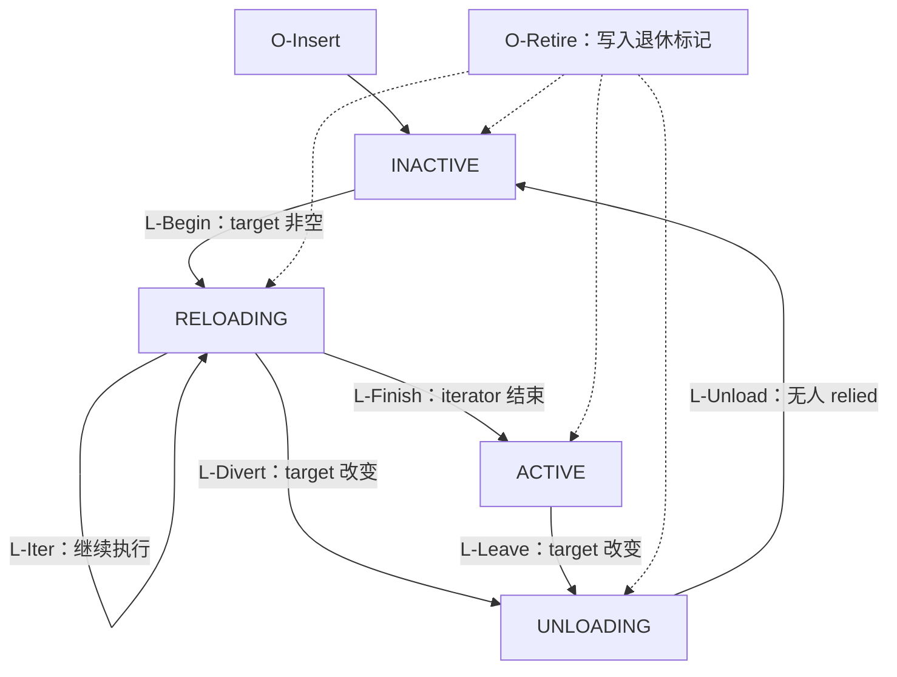

虚线表示 O-Retire 可以在任意生命周期状态设置退休标记；真正的状态迁移仍由生命周期规则完成。

#### 4.2.3 Confinement：读写边界

**定义55**规定 map 对 fiber \(n\) confined：

- **Writes**：只能修改 fiber 自己的表，以及它声明依赖的 key 在 provider 表中的对应 binding；不能任意改写其他 fiber 的控制字段或表。
- **Reads**：只能依赖自己的表，以及其他 fiber 表中属于自己依赖声明 \(d_n\) 的部分；不能观察未声明的表或其他 fiber 的生命周期控制字段。

**定义56**把 context-mediated iterator stages 提升到 registry 状态：

- operation stage 只能作用于 \(d_n\cup p_n\) 中的 key；
- provision stage 只能作用于 \(p_n\) 中的 key；
- 还允许通过实例化原语创建子 fiber。

**引理57**证明：按定义56构造的 iterator 都 confined to \(n\)，并满足组件定义48要求的 witness。这是后续完整枚举状态变化来源的基础。

### 4.3 Metatheory：元理论（39–55页）

#### 步骤分解与不变量（39–42页）

**定义58**给运行序列编号，\(\gamma^t\) 表示前 \(t\) 步后的状态。一个 fiber 的 **episode** 是它连续处于 installed 状态的最大区间，始于 L-Begin，终于 L-Unload；最终 episode 也可能在序列结束时仍未关闭。

每一步分解为：

$$
\gamma^{t+1}=edit_t(\Psi_t(\gamma^t))
$$

- \(\Psi_t\)：状态映射部分。L-Iter、L-Finish、落地式 L-Divert 使用 iterator 的状态映射；L-Unload 使用 accumulator；其他规则为恒等映射。
- \(edit_t\)：改写生命周期状态、退休标记或 registry domain 等控制字段。

**引理59**总结五项规则不变量：

1. 表的变化只来自 \(\Psi_t\)。跨 fiber 的表变化只发生在被操作 fiber 声明的依赖 key 上，且不改变表 domain。
2. committed view 只在该 fiber 的 L-Begin 创建，在 L-Unload 清除，因此在整个 episode 内保持不变。
3. accumulator 只在该 fiber 的 L-Unload 应用。
4. installed 从假变真只可能由 L-Begin 引起，从真变假只可能由 L-Unload 引起。
5. parent、依赖、provision、effect function 随插入确定，不再改写；retirement flag 只从 \(\bot\) 单调变为 \(\top\)。

**状态等价 \(\simeq\)** 比较 coeffect tables 的等价性、registry domain，以及每个 fiber 的控制字段。它忽略 key 等价关系本身不观察的状态差异，但保留影响规则适用性的控制信息。

- **引理60（\(\simeq\)-invariance）**：等价状态适用相同规则，执行后仍等价。
- **引理61（Equivariance）**：对 fiber names 作一致双射重命名，不改变规则适用性和转换结构。
- **引理62（Vestigial entries）**：退休、INACTIVE、空表且无子节点的 vestigial entry 对规则观察不可见；删除它不会改变其他 fiber 的行为（除涉及该 name 的新插入情形）。

#### 4.3.1 Preservation：良构性保持（43页）

**定义63**规定 registry well-formed 的四个条件：

1. 每个 fiber 的 parent 是 root 或 registry 中已有 fiber。
2. 不同 fiber 的 provisions 两两不相交。
3. installed fiber 的 committed view 在 \(d_n\) 上全定义，并映射到 registry 中的 fiber。
4. 若 installed fiber \(n\) 的依赖 key \(k\) 在 committed view 中解析到 \(m\)，则 \(m\) 也必须 installed。

**定理64（Preservation）**：若一步之前 registry 良构，则九条规则中的任意一步执行后仍然良构。

证明分别依赖：O-Insert 的 parent 与 provision 前提；L-Begin 只在依赖满足时记录 committed view；L-Unload 的 `¬ relied` guard 保证 provider 离开时没有 installed consumer 仍指向它。

推论：安全移除后的 name 可以重新使用；fiber 已 INACTIVE 时可移除，不需额外检查消费者，因为 guard 已在此前卸载过程中排除依赖关系。

#### 4.3.2 Temporal Composability：跨 fiber 交错下的恢复（44–47页）

全局问题在于：fiber \(n\) 构造 accumulator 后、真正卸载前，其他 fiber 可能改变状态。此节证明交错操作不会破坏 \(n\) 的恢复保证。

**定义65**：

- iterator independent：满足第3章定义42的独立性条件。
- fibers entangled：一方 provision 与另一方 dependency 或 provision 有交集。
- pairwise independent sequence：任意两 fiber 要么 iterator 独立，要么 entangled 但它们共同操作的 key 必须 commutative。

**引理66（Pairwise independence）**：每个合法步骤序列都是 pairwise independent。每个 key 的 coeffect witness 提供操作交换性；不 entangled 的 fiber 满足独立性的接口条件；这些性质通过 lift 传到 registry 状态。同一组件的两个 fiber 也包含在论证中。

**引理67（Entangled steps）**：对于 entangled fibers，不能简单要求它们的 effect maps 在所有状态上独立，因为消费者的操作可能作用于 provider 安装的 binding。生命周期规则与 guard 确保：若对方提供当前 fiber 所依赖或提供的 key，provider 不会在依赖者仍使用它时卸载；其他允许的交错操作仍可在当前状态上交换。尤其当目标 fiber 仍在 RELOADING 时，相关 entangled fiber 不会插入破坏该转换的状态变化。

**定理68（Recovery exactness）**：设 \(n\) 的 episode 从 \(b\) 开始，在 episode 内时刻 \(u\)，将当前 accumulator \(g_n^u\) 应用于当前状态，所得结果在 \(\simeq_K\) 下等于从 episode 开始状态出发、只执行期间所有其他 fiber 步骤的结果：

$$
g_n^u(\gamma^u)\simeq_K
(\Psi_{t_l}\circ\cdots\circ\Psi_{t_1})(\gamma^b)
$$

其中 \(t_1<\cdots<t_l\) 是区间内作用于 \(n\) 以外 fiber 的步骤索引。

直观含义：应用 \(n\) 的 accumulator 后，撤销 \(n\) 自己的贡献，同时保留其他 fiber 的贡献；结果如同 \(n\) 没有执行自己的效果。

**推论69（Terminal recovery）**：episode 关闭时，完整状态在 \(\simeq_K\) 下等于跳过 \(n\) 自己步骤、保留其他 fiber 步骤的结果；特别地，\(n\) 的表为空，满足 O-Remove 的空表前提。

恢复不是物理状态逐字节还原，而是相对于 key 定义的等价关系。单调 allocator 不会倒退；heap layout 的释放不代表原布局恢复；已发送消息不会被撤回。没有被 key reify 的外部状态也不在该恢复保证范围内。

#### 4.3.3 Spatial Composability：provider/consumer 顺序（47–48页）

全局空间可组合性要求：provider 只有在所有已解析到它的 dependent 停用后才能撤回 binding；一个 fiber 激活过程中所依据的 provider resolution 不能悄然改变。

**定理70（Ordering）**：

1. fiber 只有在 dependencies 已被提供时才能开始 transition。
2. 若 \(m\) 的依赖 key \(k\) 在 committed view 中解析到 provider \(n\)，则 \(n\) 的 episode 先于 \(m\) 开始；若 \(n\) 的 episode 关闭，则必须晚于 \(m\) 的 episode 关闭。provider 生命周期覆盖 consumer 的相关生命周期。
3. 在 consumer episode 期间，provider 对应 binding 始终存在；binding 的值只能由声明该 key 的 fiber 在该 key 上的操作改变。

依据是 L-Begin 要求依赖满足，L-Unload 的 guard 要求没有 committed view 仍依赖该 provider。

**定理71（Resolution coherence）**：episode 开始时记录 committed view \(\omega\)。在 RELOADING 的初始区间，每一次 L-Iter 或 L-Finish 都要求当前 target 仍等于 \(\omega\)。随后只有两种结果：

1. L-Finish 成功，进入 ACTIVE 并保留该 committed view；
2. L-Divert 发现 target 已变化，转入 UNLOADING，最终由 accumulator 恢复（推论69）。

因此组件不会把基于旧 provider resolution 计算的效果当作成功激活结果继续公开；resolution 改变时走撤销路径。

#### 4.3.4 Progress：无死锁与终止（49–50页）

**定义72：precedence relation**

$$
n\prec m\iff p_n\cap d_m\ne\varnothing
$$

表示 \(n\) 可能提供 \(m\) 声明依赖的 key。该关系只由 \(d,p\) 决定。作者强调，\(\prec\) 无环是定理假设，不是定义自动保证的；若组件依赖自己提供的 key，可能有 \(n\prec n\)。它描述激活先后，而 provider 生命周期覆盖 consumer 是定理70的结论。

**定理73（Progress）**假设：

- \(\prec\) 无环；
- 每个 iterator 长度有统一上界 \(K\)；
- 整个序列曾经持有的 fiber names 集合 \(N\) 有限；
- 每一步应用生命周期规则。

结论：

1. **No deadlock**：若系统尚未 quiet，至少有一条生命周期规则可应用。

2. **Termination**：每个 fiber 的步骤数满足
   $$
   S(n)\le (K+3)(V(n)+1)
   $$
   其中 \(V(n)\) 为 target view 改变次数；\(V(n)\) 和所有 fiber 的总步骤数均有限。

证明要点：INACTIVE 且 target 非空时可 L-Begin；RELOADING 且 target 一致时可 L-Iter 或 L-Finish；RELOADING 且 target 改变时可 L-Divert；ACTIVE 且 target 改变时可 L-Leave。若只剩 UNLOADING fibers，则沿仍依赖它们的 fiber 追踪，追踪沿无环的 \(\prec\) 前进；有限 registry 保证最终找到无人依赖的 UNLOADING fiber，L-Unload 因而可用。

终止性通过计数证明：target 不变的一段区间内，一个 fiber 最多执行 \(K+3\) 步；target 改变要么由 precedence 更低的 fiber 的步骤引起，要么由该 fiber 自己单调的退休标记引起。无环与有限 names 使递归计数有界。

\(N\) 有限是显式假设。若组件可以无限递归实例化自己，就可能产生无限多 fiber；禁止无界自实例化有助于保证实例集合有限。

#### 4.3.5 Confluence：动态历史不影响最终静止状态（51–55页）

本节主张：只要执行到 quiescent state，最终状态就与把最终仍有效的组件按依赖顺序一次性装配的结果相同（在论文定义的等价关系及 name renaming 下）。

Confluence 讨论生命周期关系，不是说不同 orchestrator 输入会得到相同结果。定理固定同一组 orchestration steps，只研究生命周期调度差异是否改变终态。

**定义74：support**。fiber supported 当且仅当：未退休；其 parent（若非 root）supported；其每个依赖 key 都由某个 supported fiber 提供。支持关系 \(\triangleleft\) 合并 provider→consumer 的 precedence 与 parent→child 的实例化关系。

**引理75（Support is well founded）**：在 \(\prec\) 无环且状态由合法步骤序列到达时，\(\triangleleft\) 良基，support 集合 \(A\) 唯一，只由退休标记、parent、依赖和 provision 决定，不依赖调度历史。

**定义76：total on its provision**。组件成功完成激活时必须安装其 provision 中每个 key，因此 ACTIVE fiber 满足 \(dom(\sigma_n)=p_n\)。这是关于组件本身的条件，并非演算自动保证。

**引理77（Support at quiescence）**：若 precedence 无环、状态 quiet，且所有组件 total on their provision，则 support 集合 \(A\) 恰好等于所有 ACTIVE fibers。

**引理78（Transposition）**给出相邻步骤交换条件：

1. 两个不同 fiber 的 activation steps 在条件满足时可交换，两个顺序到达相同状态；依据是 iterator 独立，且对方步骤不破坏 target 等前提。
2. 一个 activation step 与另一个 fiber 的 orchestration step，在 activation 不实例化那个 fiber 时也可交换。

**引理79（Deletion）**：在 totality 等条件下，若某 fiber episode 已关闭，且没有更高 precedence 的 fiber episode 同时关闭，也没有该 episode 实例化的子 fiber 留下 episode，则可以删除该 episode 的步骤及其所实例化 fiber 的步骤，而最终状态在规定等价关系下不变。核心依据是推论69：accumulator 能撤销该 fiber 的全部贡献。

**定理80（Confluence）**：

1. **Canonical form**：任何到达 quiescent state 的执行序列，都可重排为规范顺序：保持原有 orchestration steps 的相对顺序；orchestrator 插入的 fiber 先于其生命周期步骤；实例化产生的 fiber 在实例化它的步骤之后；最终 supported 集合 \(A\) 按 \(\triangleleft\) 的线性化顺序，每个 fiber 只执行一个完整 episode。
2. **Confluence**：任意两条采用相同 orchestration 输入的规范序列，最终状态在 name renaming 后由定义58的等价关系联系，因此也满足 \(\simeq_K\)。

证明结构：

- 用引理79逐个删除所有关闭的 episode，因为它们对最终状态没有净贡献。
- 用引理78把 orchestration steps 移到规范位置。
- 按 support 关系拓扑顺序整理仍然 active 的 episode。
- 不同线性化只在不可比较的 episode 顺序上不同；这些 episode 可交换，因此终态等价。

作者据此指出，可以把 Cordis 应用的 quiescent state 当作静态装配结果来推理。即使系统经历 provider 替换、组件移除和撤销，只要最终配置相同，最终静止状态就与一开始直接装配该配置相同。

定理只保证**状态**，不保证执行过程中产生的外部 emission 历史相同。第6.1节进一步区分可追踪、可恢复的 acquisition 与越过系统边界的 emission。

### 4.4 Extensions：演算扩展（55–57页）

#### Asynchrony：异步

基础演算同步地整体应用每一步状态映射。异步 host 中，iteration 和 inverse 可能返回 future；开始运行后，即使已经不再需要，也可能必须执行到完成。这种 host 是 **inertial**：

- L-Divert 只能让当前 iteration 落地，不能中止正在执行的 iteration。
- 若 target 在 iteration 期间变化，fiber 等 iteration 完成后再进入 UNLOADING，并把该 iteration 产生的 inverse 纳入 accumulator。

第4.3节结果对所有合法步骤序列成立，因此也覆盖 inertial host。定理73不依赖 aborting 分支，所以异步限制仍能 quiesce。

inverse 的应用不需要类似 inertia：卸载规则不会拒绝执行；其他 fiber 在 accumulator 执行期间的步骤可与尚未应用的 inverse 交换。因此分散在一段时间执行的 inverse，最终仍达到与一步应用相同的状态（在 \(\simeq_K\) 下）。停用后也可直接重新激活，对应实现中的 reload/unload mutual chaining。

#### Failure：失败

外部操作可能失败，如端口已占用、文件不存在、对端无响应。扩展后的 iterator 迭代可能返回错误，而非正常三元组。

失败分支不需要 inverse，因为失败迭代没有成功安装可撤销效果；fiber 通过类似 aborting L-Divert 的路径退出 RELOADING，撤销此前成功迭代累积的效果，回到 INACTIVE，并把错误 outcome 保存在 fiber 上。

失败 fiber 不会在环境不变时自动重试；重试需要 revision，重新插入一个没有错误 outcome 的 fiber。错误不向 parent 传播，siblings 可继续运行。

**Confluence 排除 failed fibers**：不同调度可能使某次迭代在一个执行中失败、在另一个执行中成功，因此 quiescent states 的该 fiber 生命周期状态可能不同。恢复保证仍成立：失败 fiber 通过卸载路径撤销已成功安装的部分效果。

#### Isolation：realm 隔离

基础演算把 key 放在共享 realm，要求 provisions 全局不相交。多 realm 可把 key 空间扩展为 \(K\times R\)。pair \((k,r)\) 继承底层 key \(k\) 的值类型、操作和 commutativity witness。

fiber 插入时按 realm table \(\rho\) 将接口 key 映射为对应 pair。这样不同 realm 中同一个底层 key 是不同 pair，provision 只需在同一 realm 内不相交，依赖也在声明时对应的 realm 中解析。

规则把 key 当作原子标识，只比较相等性，不分析内部结构，因此第4.3节规则和定理可直接应用在扩展 key 集 \(K\times R\) 上。运行时改变 fiber realm 会改变接口；由于 \(d,p\) 在插入时固定，这种改变应视为 revision。interception 只改变 binding 的使用方式，不改变 key 解析对象，因此不需要扩展规则。

#### Configuration：配置与 revision

实现中的组件带 configuration，实例化时将 payload 绑定进 effect function。因此，同一组件代码绑定不同 payload，在形式上是 effect function 不同的两个组件。

声明式 loader 允许对运行中的 fiber revision：更换 configuration、改变 realm、disable/re-enable。revision 由已有规则组合而成：退休旧 fiber，等待生命周期停用，按 child-before-parent 顺序移除，再以相同 name 插入新 fiber（携带新 effect function 或 realm）。

不能简单把退休标记从 \(\top\) 改回 \(\bot\)：定理80依赖退休标记单调性；而 child 的 creator 可能已退出，直接复活旧 fiber 可能使它在 creator 不存在时激活。因此实现区分：

- **entry identity**：跨 revision 保持的配置项身份；
- **fiber identity**：某一次 enablement 的运行实例。

revision 只要求最终 endpoint 正确。依据定理80，最终 quiescent state 等价于从头加载修订后配置的结果。

### 全章逻辑关系图

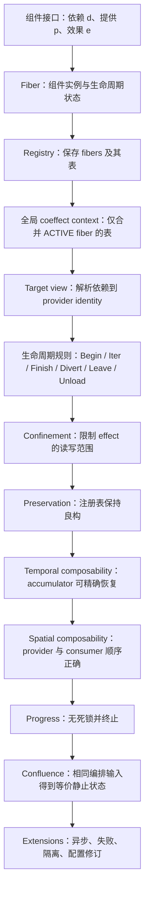

### 关键概念对照

| 概念                 | 作用                                           | 不应混淆之处                                         |
| -------------------- | ---------------------------------------------- | ---------------------------------------------------- |
| \(d\)                | 组件依赖声明                                   | 不等于组件提供的 key                                 |
| \(p\)                | 组件可提供的 key 集合                          | 不等于任意时刻已安装的 binding                       |
| \(\sigma_n\)         | fiber 自有表                                   | 不等于全局公开 context                               |
| \(\sigma_\gamma\)    | ACTIVE fiber 表的并                            | RELOADING/UNLOADING 表不在其中                       |
| \(\omega_n\)         | 激活时提交的 provider resolution               | 记录 provider identity，不只是值                     |
| \(target_n(\gamma)\) | 当前状态下应采用的解析                         | 与 committed view 比较以触发生命周期变化             |
| \(g_n\)              | 已累积 inverse 的 accumulator                  | 只在 L-Unload 应用                                   |
| `relied_n`           | 是否仍有 consumer committed view 指向 provider | provider 最终卸载的 guard                            |
| \(\prec\)            | provision/dependency 导出的 precedence         | 激活先后；生命周期覆盖关系由定理70证明               |
| \(A\)                | support set                                    | 在 totality 与 quiescence 条件下才等于 ACTIVE fibers |

### 定理速查表

| 编号                      | 名称                                   | 核心结论                                                     |
| ------------------------- | -------------------------------------- | ------------------------------------------------------------ |
| Lemma 57                  | Confinement / witness                  | iterator 满足 fiber 读写边界与 witness                       |
| Lemma 59                  | Step invariants                        | 表、committed view、accumulator、installed 与接口字段的变化受规则限制 |
| Lemma 60                  | \(\simeq\)-invariance                  | 等价状态有相同规则适用性，执行后仍等价                       |
| Lemma 61                  | Equivariance                           | fiber name 一致重命名不改变演算                              |
| Lemma 62                  | Vestigial entries                      | vestigial entry 对其他 fiber 的规则行为不可见                |
| Theorem 64                | Preservation                           | 每条规则保持 registry well-formed                            |
| Lemma 66–67               | Independence / Entangled steps         | key commutativity 与生命周期 guard 处理交错                  |
| Theorem 68 / Corollary 69 | Recovery exactness / Terminal recovery | accumulator 撤销 fiber 自身贡献，保留其他 fiber 效果         |
| Theorem 70                | Ordering                               | provider/consumer 生命周期顺序正确                           |
| Theorem 71                | Resolution coherence                   | 激活使用固定 committed resolution，否则转入撤销              |
| Theorem 73                | Progress                               | 在无环、有限等假设下无死锁且终止                             |
| Theorem 80                | Confluence                             | 同一编排输入下，不同生命周期调度得到等价静止状态             |

## 5 实现与案例研究（论文第57—70页）

> **章节定位**：本章介绍 Cordis 如何把前文的“可撤销效应（revertible effects）”与“响应式余效（reactive coeffects）”落实为可用的软件框架，并通过 Koishi 的插件生态说明该抽象能够支撑真实系统。内容分为三层：核心库、组件加载器、应用案例。
>
> **阅读范围说明**：第5章从论文印刷页码57开始，Koishi 案例在第70页上半部分结束；第70页后半部分开始第6章。

### 5.1 Cordis 的整体实现思路

Cordis 是一个面向动态组合的 **meta-framework（元框架）**，而不是面向某个业务领域的应用框架。它不规定系统必须做聊天、Web 路由、ORM 或 UI，而是统一处理组件运行时加入、退出、依赖变化和重新配置时的组合语义。

实现分成三个层次：

1. **Core Library（核心库）**：提供上下文、效应跟踪、余效解析、组件生命周期和上下文访问等基础原语。
2. **Component Loader（组件加载器）**：把组件组合描述为声明式配置树，并将配置变化增量地转换为核心库操作；同时提供热模块替换（HMR）。
3. **Application Framework（应用框架）**：例如 Koishi，在 Cordis 原语上构建具体领域功能。

这一分层的关键是：核心库掌管“如何安全组合”，加载器掌管“想要怎样的组合”，应用框架掌管“这些组件具体提供什么业务能力”。

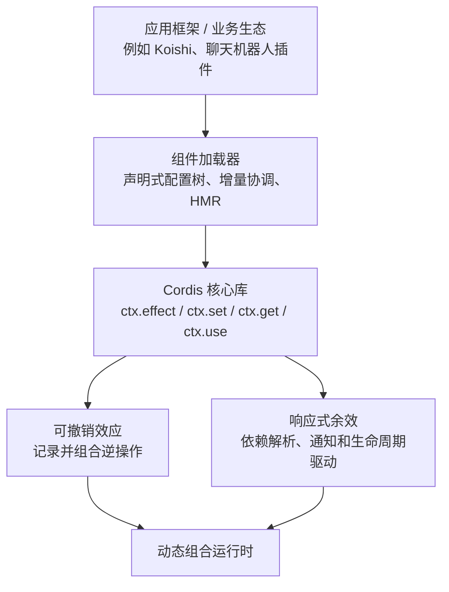

#### 5.1.1 理论概念与运行时对象的对应关系

论文用一张对应表（Table 2，第58页）把理论符号映射到实现对象。理解这张表可以把前文数学模型与代码 API 连起来：

| 理论概念                     | Cordis 中的实现                                      | 含义                                              |
| ---------------------------- | ---------------------------------------------------- | ------------------------------------------------- |
| 全局上下文 \(\Gamma^\infty\) | `ctx`                                                | 一等的运行时上下文对象                            |
| 当前上下文状态 \(\gamma\)    | 上下文树及系统已触及的状态                           | 不只是一个 map，还包含运行时组合结构              |
| 效应函数 / 效应迭代器        | effect callback                                      | 通过返回或逐步 yield 逆操作，供运行时回收         |
| `effect_Γ(e)`                | `ctx.effect(callback)`                               | 将效应纳入跟踪机制                                |
| 值存储、隔离表、拦截表       | `ctx[@@store]`、`ctx[@@isolate]`、`ctx[@@intercept]` | 分别保存值、键到 realm 的映射、键的访问元数据     |
| 余效读取 / 提供              | `ctx.get(key)`、`ctx.set(key, value)`                | 获取或提供某个依赖键                              |
| 组件实例                     | `fiber`                                              | 一个组件的一次实例化及其生命周期状态              |
| 组件依赖声明                 | `fiber.inject`                                       | 该组件需要的依赖键集合                            |
| 组件提供集合                 | `fiber.provide`                                      | 该组件对外提供的依赖                              |
| 组件效应函数                 | `fiber.apply`                                        | 已绑定配置、由生命周期执行的函数                  |
| 父级与子上下文               | `fiber.parent`、`fiber.ctx`                          | 构成组件层级和上下文派生关系                      |
| 生命周期状态                 | `fiber.state`                                        | 例如 `LOADING`、`ACTIVE`、`UNLOADING`、`INACTIVE` |
| 回收累积器                   | `fiber.dispose`                                      | 该 fiber 已安装效应的逆操作组合                   |
| 已提交依赖视图               | `fiber.committed`                                    | 当前生命周期中组件可见的依赖视图                  |
| 目标依赖视图                 | `fiber.target`                                       | 重新解析后组件应当依赖的 provider 组合            |
| 进行中的迁移                 | `fiber.inertia`                                      | reload/unload 异步迁移任务的句柄                  |

作者特别说明：`ctx[@@store]` 等是框架内部的 symbol-keyed 槽位，不应理解成普通字符串键字典。

### 5.2 核心库（5.1）

核心库的职责是把所有影响上下文的操作收束到统一机制中。后续组件实例化、依赖提供、依赖撤销等动作，最终都借助 `ctx.effect` 完成跟踪；依赖变化再由通知机制驱动 fiber 生命周期。

#### 5.2.1 效应跟踪：`ctx.effect`（5.1.1，第59—60页）

**核心原则：所有经由 Cordis 上下文执行的修改，都必须经过一个统一的效应入口。** `ctx.effect(callback)` 是上下文变更的唯一基础原语。组件作者在 callback 中执行修改，并把恢复动作交给运行时；卸载时运行时自动调用这些恢复动作。

实现支持两种输入形态：

- 普通效应函数：可以看成只产生一个逆操作的退化情况。
- 效应迭代器：每一步执行后都可以 yield 一个逆操作，适合多阶段或异步效应。

`execute` 会驱动迭代器，并把每一步产生的 inverse 累积为一个恢复函数。新 inverse 以 `value ∘ inverse` 的方式合成，因此**后发生的操作先撤销**，即 LIFO（后进先出）顺序。这与资源获取/释放的栈式纪律一致。

`ctx.effect` 在 `execute` 外又加了两项保证：

1. **自身可撤销且至多撤销一次**：内部 `armed` 标志控制执行。调用 disposer 时先将其置为 `false`，从而阻止尚未执行的迭代步骤继续前进；随后等待当前任务收束，再调用已累积的恢复函数。重复调用 disposer 不会重复应用逆操作。
2. **与父上下文累积器组合**：新的 disposer 被组合进父上下文的 `ctx.dispose`。因此子组件的效应回收本身也成为父组件生命周期内的效应；卸载父组件时，会递归带走子组件所安装的内容。

执行期间每次推进迭代器之前都会检查 guard。guard 一旦失败，后续步骤停止，只回收已经完成且已记录 inverse 的部分。这就是运行时对“在步骤边界中断”的实现。

**重要限制**：运行时并不证明 callback 提供的 inverse 一定能恢复原状态。逆操作的正确性<u>仍是组件作者的义务</u>；论文指出形式化证明在演算部分会用到这一前提，并在第6.1节进一步讨论它受系统边界限制。同样，余效见证所需的操作可交换性也不是运行时自动验证的。

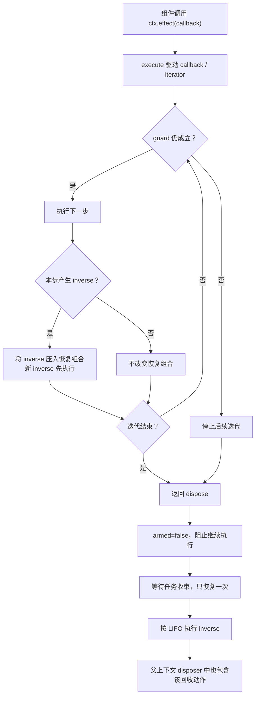

#### 5.2.2 余效操作：提供、通知、隔离与拦截（5.1.2，第60—61页）

每个上下文都携带三个内部表：

- `@@store`：值存储表，把 realm symbol 映射到实际值。
- `@@isolate`：隔离表，把余效 key 映射到 realm symbol。
- `@@intercept`：拦截表，为每个 key 保存访问元数据。

依赖读取采用两层间接寻址：

$$
key \xrightarrow{@@isolate} realm \xrightarrow{@@store} value
$$

这两层的意义不同：`isolate` 决定某个 key 应落在哪个独立绑定空间；`intercept` 不改变 key 实际解析到哪个值，而是在访问时改变该依赖的使用方式。

**提供与通知**：

- `ctx.set(key, value)` 通过 `ctx.effect` 将值绑定到 key 对应的 realm。
- 该绑定自带 disposer；撤销时从 store 删除该值。
- 安装和撤销两个动作都会调用 `notify`，使依赖变化传播到相关 fiber。
- `notify` 遍历运行中的 fibers：当变化的 key 属于其 `inject`，且依赖解析到相同 realm 时，就调用 `refresh` 重新计算目标依赖视图。
- 若依赖是否满足发生变化，就触发激活或停用；若变化对满足状态没有影响，则 refresh 的幂等性使其成为无害的中性变化。

特别重要的是：**某个绑定只有在安装它的 provider 处于 `ACTIVE` 时，才算对 consumer 可用。** 因此 provider 进入 `UNLOADING` 后，会先从“可提供者”视图中消失，dependents 随即开始退场；但此时 provider 的绑定及资源尚未被逆操作真正删除。这样就给了依赖者先停用的机会。

**隔离（isolation）**：`ctx.isolate(key, realm)` 派生一个子上下文，覆盖该 key 的 realm 映射。默认情况下可生成新的 symbol，使两个上下文即使使用同一个 key，也能解析到彼此独立的绑定。由于这是派生上下文而非修改父上下文，丢弃子上下文即可恢复，不需要额外 inverse。

**拦截（interception）**：`ctx.intercept(key, metadata)` 同样派生上下文，但修改的是拦截元数据表。新元数据与原有 metadata 合并，并按论文定义的优先级覆盖。它用于在访问时调整依赖使用策略，而不改变依赖是否存在。

#### 5.2.3 组件生命周期：fiber 状态机（5.1.3，第61—64页）

组件通过 `ctx.use(ctx, component, config)` 实例化成一个 **fiber**。组件由两部分组成：

- `component.inject`：余效声明，列出组件运行需要的依赖键；
- `component.apply`：效应函数，实例化时把 `config` 绑定进去，成为 fiber 真正运行的 `apply`。

fiber 保存父上下文、子上下文、依赖声明、配置绑定后的 apply、生命周期状态、目标依赖视图、已提交依赖视图、回收函数及正在执行的异步迁移句柄。

`ctx.use` 本身也是父上下文中的一个受跟踪效应：安装时创建子 fiber 并触发 `refresh`；撤销时将其 `target` 置为空（\(\bot\)）并触发 `unload`。因此父组件卸载自然会触发子组件退出。

**四个主要状态**：

| 状态        | 含义                                                         |
| ----------- | ------------------------------------------------------------ |
| `INACTIVE`  | 未运行，或依赖尚未满足                                       |
| `LOADING`   | 正在执行组件效应、安装自身提供项                             |
| `ACTIVE`    | 当前目标依赖视图已满足且组件加载成功                         |
| `UNLOADING` | 已停止对外提供能力，正在等待依赖者并撤销自身效应             |
| `FAILED`    | 生命周期执行失败时记录错误结果；实现对应关系中失败 fiber 的目标被置为空 |

**refresh / reload / unload 的协作**：

1. `refresh` 根据当前 coeffect store 重新解析组件所有依赖，得到 `target`。目标不变则直接返回；目标变化时更新 `fiber.target`。
2. 如果 fiber 已处于一个生命周期迁移中（`inertia` 非空），不启动并行迁移，而是让当前迁移走到一个确定的收束点，再检查新目标。
3. 新目标非空时进入 `LOADING` 并启动 `reload`；目标为空时先标记 `UNLOADING`，随后启动 `unload`。
4. `reload` 先把本次解析到的依赖视图写入 `committed`，然后在 guard（目标保持不变）下执行 `fiber.apply`。如果执行后目标仍一致，则进入 `ACTIVE` 并通知自己的 dependents；若目标已变化，则转入 `UNLOADING`。
5. `unload` 先通知并等待所有受影响的 dependents 完成停用，再执行 `fiber.dispose` 回收自身效应；清空 disposer 与 committed view。若目标仍为空，则进入 `INACTIVE`；若新目标已经重新满足，则衔接一次 `reload`。

**为什么称为 inertial（惯性）生命周期**：一次 reload 或 unload 一旦开始，就不会被新目标直接取消；它必须完成到一个状态边界，再根据最新 target 接续下一次迁移。另一方面，`execute` 在每个迭代步骤边界检查 target，目标过期时可停止后续步骤并回收已完成部分。这分别对应迁移之间的惯性衔接与单次迁移内部的过期检查。

**target 用 provider 的 fiber UID 表示，而不是依赖值本身**。UID 新鲜且不复用，因此 provider 被另一个组件替换时，即使新旧 provider 提供了相等的值，也会被识别为依赖来源改变并重新加载 consumer。相反，同一个 provider 原地覆盖自己的绑定不会被识别成 provider 替换；若要让替换传播，组件应先撤销绑定再重新安装。

**依赖退出顺序的三个关键点**：

- `refresh` 在安排 unload 任务之前先标记 `UNLOADING`，让 provider 立即停止被视为可用。
- `unload` 在执行自身 inverse 前，先等待通知到的 dependents 进入 `INACTIVE`。
- `committed` 视图直到逆操作完成后才丢弃，使正在 teardown 的组件仍能读取它曾经提交的依赖视图。

这样 provider 的退出顺序是“先让消费者停止，再撤销提供者”，避免依赖者在清理期间失去它仍需要访问的依赖。

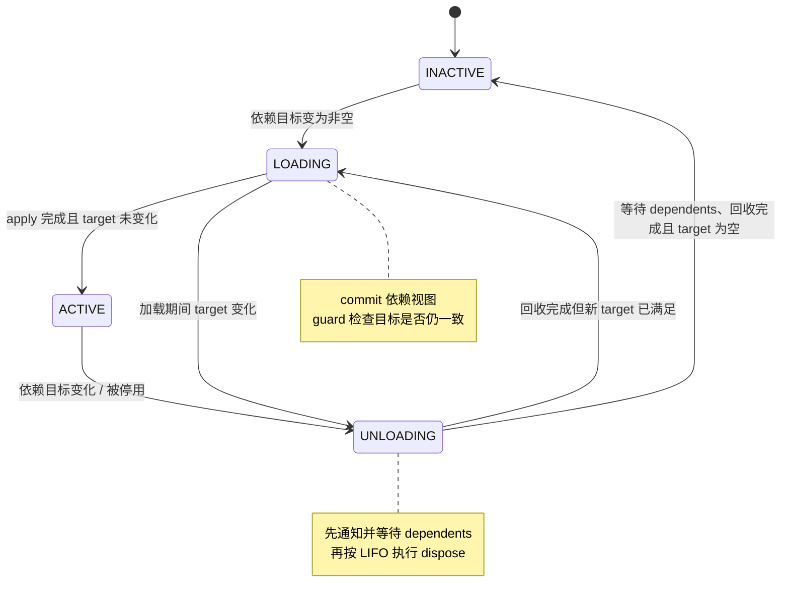

#### 5.2.4 上下文访问：Proxy 将依赖声明变成访问控制（5.1.4，第64页）

Cordis 提供两种读取方式：

- 反射式 API：`ctx.get(key)` 直接从 store 查询，取值或得到空值，不会因为未声明而报错。
- 属性式 API：`ctx[key]` 通过 TypeScript `Proxy` 的 `get` trap 访问。它沿 fiber 父链向上查找已提交的依赖视图：
  - 在某个 fiber 的 `committed` 中找到 key：返回绑定值；
  - 找到某个 fiber 声明了 key，但该 fiber 尚未提交该依赖视图：抛出 `INACTIVE_ACCESS`；
  - 一直走到 root 仍没有声明：抛出 `UNDECLARED_ACCESS`。

属性式访问比裸 `get` 更严格：它以**当前 fiber 已提交的依赖视图**为准，而不是仅看全局 store 是否存在值。因此组件只能读取声明过、且当前生命周期已满足的依赖。论文还指出，由于 `inject` 是静态声明，这种访问违规原则上也可在编译期提前检查；第6.4节讨论了语言层面的实现方式。

### 5.3 组件加载器（5.2）

核心库偏向组件作者，提供 `ctx.effect`、`ctx.use`、`ctx.set` 等命令式原语；组件加载器偏向系统编排者，让编排者声明整个系统“应该由哪些组件构成”，然后由 loader 自动把声明与运行时 fibers 协调一致。

#### 5.3.1 声明式配置树（5.2.1，第65—67页）

每个配置 entry 描述一个 fiber，包含六个字段：

| 字段        | 用途                                                  |
| ----------- | ----------------------------------------------------- |
| `id`        | 稳定标识；同一组子节点增删改时用作 reconciliation key |
| `url`       | 组件模块 URL，决定实例化哪个组件                      |
| `isolate`   | 应用于该 entry 上下文的隔离注解                       |
| `intercept` | 应用于该 entry 上下文的拦截注解                       |
| `config`    | 绑定到组件效应函数的配置负载                          |
| `disabled`  | 管理层面是否关闭该 entry                              |

配置是一棵树：叶子 entry 对应单一 fiber；分支 entry 可继续加载子组件。论文列举两个以普通组件形式实现的加载器组件：

- `@cordisjs/group`：把配置中的子 entry 列表作为子组加载。
- `@cordisjs/include`：读取外部 YAML 或 JSON 配置，并把其 entry 子树挂载进当前配置树。

配置树是系统当前期望加载内容的权威记录。绑定是双向的：loader 根据 entry 字段变化调整 fiber；组件自身修改配置或关闭自身时，也把修改反映回 entry。

**为何可以增量协调，而不是整体重启？** 论文引用前文演算的几个结果作为依据：

- 最终 quiescent state 由最终配置决定，而不依赖中间协调步骤的具体顺序（Theorem 80）。
- 系统能够达到 quiescent state（Theorem 73）。
- 移除一个 fiber 会撤销它安装的贡献，不会破坏其余 fibers（Corollary 69）。
- fibers 可一起实例化，无需编排者提前排序；未满足依赖的 fiber 会在生命周期开始处等待，provider 退出前 dependents 会先停用（Theorem 70）。因此模块可以并发加载，依赖条件决定何时激活，而不是何时下载或求值模块。

**loader 对不同字段采取最小扰动的操作**：

- `id` 或 `url` 改变：重建 entry，因为身份或组件模块变了。
- `isolate` 改变：重新分配 entry 的 realms。
- `intercept` 改变：原位更新；它只在读取时生效，不需要 reload。
- `config` 改变：交给组件决定如何处理，组件通常比较新旧 payload，只在实质变化时 reload。对 `group` 而言，config 是子 entry 列表，于是按子 `id` 做 keyed diff，并递归应用相同的字段级更新规则。
- `disabled` 变为 true：unload；清除 disabled：重新启用。entry 是配置层持续存在的身份，而每次启用会实例化一个新的 fiber，避免把已被父级回收的旧 fiber 重新激活。

**托管 realm**：entry 可以在运行时从一个 group 移到另一个 group，因此 loader 需要比核心库的简单上下文派生更进一步地管理 realm：

- `isolate: true`：选择局部 realm，私属于该 entry，并以其 id 标识；entry 移动时这个局部 realm 随 entry 移动。
- `isolate: "某字符串"`：选择全局共享 realm；所有命名该字符串的 entry 共享同一个 realm。entry 移动时，改变的是它和哪些 entry 共享绑定。
- 当没有 entry 再引用某个 realm 时，该 realm 会被丢弃。

realm 重新分配时，loader 需要判定哪些 key 的 realm 发生变化、绑定是否属于当前 entry、以及哪些 dependents 真正受到影响。论文用每个 key 的 delimiter symbol 和上下文继承的 tag 来区分“由该 entry 的上下文派生”的 fibers。只有 provider 与 dependent 的隔离归属关系发生分离时，后者才需要被通知；若二者一起移动或一起不动，dependent 看到的绑定保持不变。

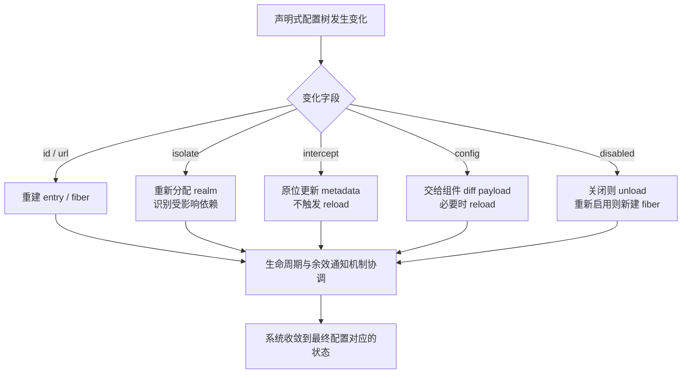

#### 5.3.2 热模块替换 HMR（5.2.2，第67—69页）

HMR 把可撤销效应模式提升到模块级：源文件改变后，不重启整个进程，而是在原运行系统中替换受影响模块。由于 fiber 已经界定组件的全部效应与余效，模块若本身就是组件，就可以通过“撤销旧 fiber + 创建新 fiber”完成替换，无需开发者额外标注 Webpack/Vite 风格的 HMR accept 边界。

论文给出三阶段算法：

**阶段1：模块分类（Algorithm 8）**

- 输入是 `stashed`（内容已改变的文件 URL）和 `externals`（不能热替换、会触发整体重启的模块）。
- 初始将 stashed 视为 accepted，externals 视为 declined，再沿依赖导入图传播。
- 若模块的 imports 与 accepted 有交集，则该模块被 accepted；若它的所有 imports 都属于 declined，则被 declined。
- 若某个模块既无法被接受，也无法被拒绝，最终未决项（例如导入环）默认并入 declined。

**阶段2：过期 entry 检测（Algorithm 9）**

- 对每个 entry，从其模块 URL 遍历传递导入依赖。
- 遍历遇到 declined 模块即停止，不跨越拒绝边界。
- 若该 entry 的依赖树与 accepted 相交，则它是 stale entry；其依赖树会并入 accepted，使后续缓存失效覆盖受影响的模块链。

**阶段3：事务式重新加载（Algorithm 10）**

1. 先使 accepted 模块缓存失效，并备份被移除的模块。
2. 对每个 stale entry，dispose 旧 fiber，再按 entry URL 重新 import 模块并创建新 fiber。
3. 如果任何一次导入或替换失败（例如语法错误），恢复模块缓存；对已处理的 stale entries 撤销当前版本，再基于备份模块重新创建旧 fiber，最后抛出错误。

这一事务回滚设计的目标是避免系统停留在“部分模块已经是新版本、部分仍是旧版本”的半更新状态。

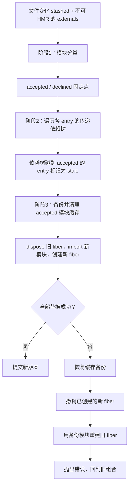

### 5.4 案例研究：Koishi（5.3，第69—70页上半部分）

Koishi 是构建在 Cordis 之上的开源聊天机器人应用框架。论文称其经过四年发展积累了 **4000 多个社区贡献插件**，类型包括即时通信（IM）适配器、数据库驱动、管理控制台和终端用户功能。作者用其规模与多样性作为生产环境验证。

**（1）表达能力与通用性**

Koishi 的服务端 bot 把功能实现成基于上下文原语的插件；Web 控制台则是另一个独立的 Cordis 应用，其插件组合的是浏览器与 UI 能力。两者领域不同，但共享相同动态组合模型。作者据此认为：

- 表达能力：这套原语足以支撑完整生产系统，领域框架只需补充特定业务词汇。
- 通用性：Cordis 固定效应和余效如何组合，而把具体语义留给应用，因此不限定某一种领域或运行时。

**（2）时间可组合性：卸载不需要插件作者手写清理流程**

Koishi 编排者可以从控制台停用插件，插件通过上下文产生的效应会在原进程中被回收；开发时，HMR 在保存代码后重新应用编辑过的插件，同时保留系统其他部分的缓存状态和活动连接。由于上下文效应会自动被跟踪、inverse 自动组合，普通插件作者无需额外写 uninstall 路径，也能获得有序清理。这把原本依赖每位作者自觉的正确性要求，转交给框架抽象统一处理。

**（3）空间可组合性：开放生态中的依赖拓扑**

Koishi 生态中存在真实的插件依赖关系：IM adapter 提供消息平台访问，数据库驱动提供持久化，功能插件声明并注入这些余效。运行时切换存储后端或重新连接 adapter 时，只重新激活解析结果确实发生变化的 dependents。依赖尚未出现的插件保持 inactive，而不是在启动时因为依赖缺失直接报错。更重要的是，插件通常由不同作者独立开发，作者之间不需要协商额外协议，只需通过连接它们的 coeffect key 约定依赖。

**（4）有效性威胁与证据边界**

作者明确指出案例研究的局限：证据来自单一生态、单一宿主语言（TypeScript），无法把编程范式本身的效果与 TypeScript 实现、Koishi 领域特性区分开；研究是观察性案例，并非与另一种架构进行受控比较。它证明的是“存在一个被采用的生产实例”，不是性能或生产力上的定量优势。运行时开销和开发者生产力相对基线的测量仍是后续工作。

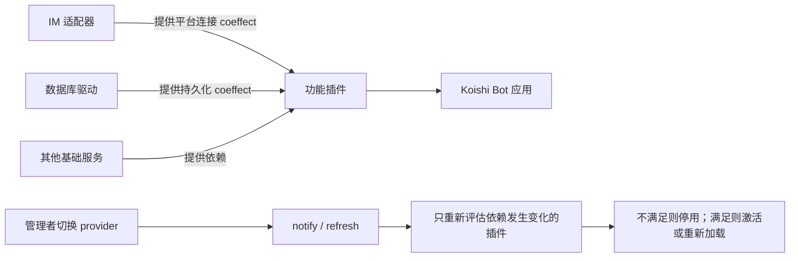

### 5.5 本章核心结论

1. **实现层面**：Cordis 把 effect tracking 与 coeffect resolution 汇聚到同一上下文对象中，使各种操作共享同一个生命周期和回收纪律。
2. **组件层面**：fiber 把依赖声明、效应执行、状态迁移和 inverse 累积封装为一个运行时单位；provider 先停止提供，dependent 先退出，随后才执行资源回收。
3. **编排层面**：声明式配置树把“期望的系统组成”与命令式运行时操作分离，并利用最终状态收敛性质做增量 reconciliation。
4. **开发体验层面**：HMR 是 fiber 粒度的卸载与重新实例化，借助备份和回滚保持替换事务的一致性。
5. **案例证据层面**：Koishi 显示这种模型可以用于开放插件生态，但论文没有给出性能开销或生产力提升的定量对照。

| 概念                                | 必须理解的问题                                               |
| ----------------------------------- | ------------------------------------------------------------ |
| `ctx.effect`                        | 为什么所有修改都必须经过它？为什么 inverse 按 LIFO 合成？    |
| `notify`                            | 什么样的 key 变化会触发哪些 fibers 的 refresh？              |
| `fiber.target` 与 `fiber.committed` | 当前依赖目标和已经提交的依赖视图有什么区别？                 |
| `UNLOADING`                         | 为什么必须先标记 provider 不再可用，再等待 dependents，最后才执行 dispose？ |
| Proxy context access                | 为什么它比 `ctx.get` 更接近依赖访问控制？                    |
| Declarative reconciliation          | 为什么不同配置字段对应不同更新策略？                         |
| HMR 三阶段                          | 如何判断模块可接受热更新、哪些 entry 过期，以及失败后如何回滚？ |
| Koishi 案例                         | 哪些事实支持时间可组合性和空间可组合性？案例又有哪些有效性威胁？ |

## 6 讨论（论文第70—77页）

> **章节定位**：第6章不再展开 Cordis 的具体算法，而是讨论“时空可组合性”落到真实工程系统时的边界、扩展方式和未解决问题。作者依次讨论：系统边界、服务多路复用、访问控制与沙箱、语言无关性、相互依赖与组件粒度、依赖类型与版本管理，以及与编程语言和操作系统的协同设计。
>
> **阅读范围说明**：第6章从论文印刷页码70开始；第70页下半部分起进入 6.1，第77页最后几段属于 6.7，随后第7章开始。

### 6.1 系统边界（6.1，第70—71页）

本节回答一个基础问题：**一个效应的 inverse 到底能够撤销什么？** 这不是单靠 inverse 函数形式决定的，而是由系统边界决定。

#### 6.1.1 边界内与边界外

系统运行环境中的某个 location，只有同时满足以下条件才算处于边界内：

1. 系统能够对它进行**排他性修改**；
2. 系统能够恢复修改前的状态。

此时，对该 location 的操作可以记录在上下文 \(\Gamma\) 中，成为可跟踪、可撤销的效应。

只要上述任一能力不成立，该 location 就在系统边界外；对它的操作在模型中相当于恒等效应 \(id_\Gamma\)，既不被跟踪，也不被恢复。

边界不是按“内存、文件、网络”等介质整体划分，而是按具体 location 划分：

- 某片内存若只有当前系统写入，可能在边界内；若其他进程也会写入，就在边界外。
- 某个文件若位于系统独占的私有临时目录中，可能在边界内；若它是其他程序也会读写的共享路径，就在边界外。

**余效（coeffect）能够移动系统边界**：把原本外部 location 包装为受控依赖，规定访问它只能通过一组由 provider 提供、且能够配套 inverse 的操作。这样，原本不受控的操作就变成经过上下文的受控操作，因而可以被跟踪和撤销。但提供这种可撤销语义会增加每次访问的成本，是一种工程权衡。

#### 6.1.2 Acquisition 与 Emission：访问获取和数据发出是两类操作

触及边界外部的操作通常可分为两个阶段：

- **Acquisition（获取阶段）**：取得外部资源访问权，并在边界内建立一条可撤销记录。例如 `open` 创建 descriptor，逆操作 `close`；`malloc` 分配内存块，逆操作 `free`；`fork` 创建子进程，逆操作 `kill`。记录本身属于 reify 外部 location 的 coeffect，而建立该记录是可撤销效应。
- **Emission（发出阶段）**：沿着已建立的通道把数据推向边界外。例如向文件写字节、向网络发送 datagram。数据发出后，其他参与者可能已经读取或修改它，所以发出动作本身相当于 \(id_\Gamma\)，不能由本系统单方面撤回。

因此，资源句柄或访问通道可以在边界内被管理，但通过该通道发出的数据通常已经跨出边界。

#### 6.1.3 对不可撤销发出的两种补救

当系统仍需要从包含外部发出的过程失败中恢复时，论文提出两种办法：

1. **Withholding（延迟发出）**：暂缓发出，直到产生数据的状态确定会持久保留。这对应 rollback-recovery 中的 output commit 问题。
2. **Compensation（补偿）**：执行一个应用层认可的补偿动作，使结果恢复到某种等价状态。例如删除刚创建的文件、退还已收取的费用。

补偿的等价标准比论文前面定义的观察等价关系更粗：应用自己决定何种结果可视为恢复。补偿动作仍然可以按 inverse 的 LIFO 顺序组合；但原先基于较细等价关系证明的交换性质，不能自动沿用，必须针对更粗的补偿等价关系重新证明。

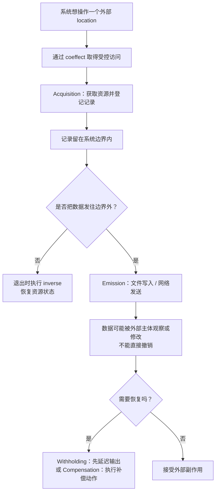

### 6.2 服务多路复用（6.2，第71—72页）

OSGi 等动态组件平台通常围绕 service 组织组件：provider 在接口下发布功能，consumer 绑定该接口。Cordis 的 coeffect key 可以对应服务接口；提供该 key 的组件是 provider，声明并注入该 key 的组件是 consumer。

当一个服务可能有多个 provider 时，作者区分两种组织方式。

#### 6.2.1 Exclusive binding 与 Service broker

**Exclusive binding（排他绑定）**：多个实现共享一个接口，但同一时刻最多绑定一个 provider。编排者决定当前绑定哪一个；切换时必须先卸载旧 provider，再加载新 provider。由于 consumer 所依赖的来源发生变化，所有相关 consumer 都会受到扰动，可能停用后再重新加载。

**Service broker（服务代理）**：把一个稳定的 broker 作为接口入口，同时注入给 backing providers 与 consumers。多个 provider 可以共存，broker 负责将每次请求分发给某个后端 provider。更新后端 provider 时，broker 本身不变，consumer 看到的依赖关系也不变，因此通常不会触发 consumer reload。

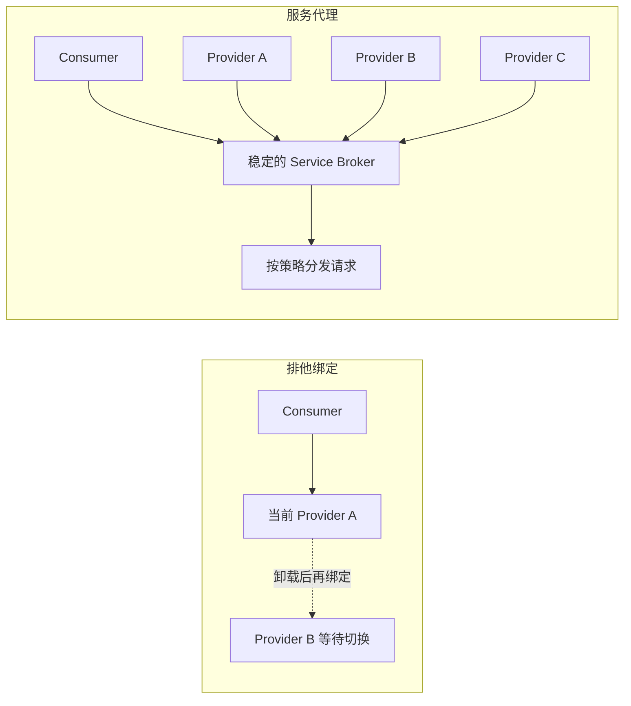

#### 6.2.2 Broker 支持的三类能力

1. **负载均衡（Load balancing）**：多个 provider 同时存在时，broker 可用轮询、最少负载、延迟权重等策略分发请求，也可由 consumer 指定目标 provider。provider 是普通组件，通过可撤销效应向 broker 注册；provider unload 时注册自动撤销，路由集合也随之更新。
2. **滚动更新（Rolling updates）**：先加载新 provider 并向 broker 注册；待新 provider 进入 `ACTIVE`，再逐步调整流量选择权重，把请求从旧 provider 转移到新 provider；等旧 provider 不再处理 in-flight 请求后，再卸载它。传统上属于容器编排或 blue-green deployment 的操作，在这里变成应用层组件组合模式。
3. **跨进程调用（Cross-process invocation）**：每个进程运行自己的 Cordis context 和本地 provider；协调组件把其他进程的 provider 作为远程 provider 接入；通过保持接口形式的 RPC 中介，让 consumer 不必关心本地或远端差异。需要注意远程调用有网络延迟，也可能在调用中途失败，所以跨进程接口必须设计成异步契约，不能假设同步调用总能及时返回。

### 6.3 访问控制与沙箱（6.3，第72—73页）

由独立组件拼装的应用需要两种互补的安全机制：

1. **依赖访问约束**：规定组件能够访问哪些依赖；Cordis 可通过 `inject` 声明和 interception 实现。
2. **不可信代码沙箱**：把恶意或不可信代码与宿主运行环境隔离；这需要语言级机制之外的执行边界。

#### 6.3.1 基于能力（capability）的访问控制

组件只能通过 Proxy 中介访问自己声明过的依赖；未声明的访问会抛错。这与 capability-based security 的思路相似：权限不是来自环境中随处可用的 ambient authority，而是来自组件明确取得的引用或能力。

在 Cordis 中：

- `inject` 声明相当于组件提出 capability request；
- context Proxy 是 capability mediator；
- 由于依赖请求在组件运行前就声明，编排者可以在加载时审查并批准所需能力，而不必等到运行时观察组件实际访问什么。

#### 6.3.2 用 interception 表达细粒度策略

访问控制 metadata 可以附着在上下文，或由组件声明；provider 在依赖被调用时读取 metadata，并判断该次请求是否被允许。例如：

- 文件系统依赖可以声明组件可读写的路径范围；
- 数据库依赖可以对社区插件授予只读权限，而核心组件仍保留完整权限。

这种策略附着在上下文而不是 provider 或 consumer 的业务代码中，因此 orchestrator 可以改变任意组件的访问限制，而无需改写 provider。拦截只改变“依赖如何被调用”，并不改变“依赖是否满足”，所以可以在运行时安装、调整或撤销，而不触发 reload，也不扰动依赖图。

#### 6.3.3 不可信组件仍需要真正的执行沙箱

语言级访问控制不是安全边界：如果恶意组件直接获得宿主 runtime 的访问权，它仍可能绕过 Proxy，直接访问底层对象。因而不可信组件需要在更强的隔离边界中执行，例如软件故障隔离、独立语言 runtime、沙箱进程或虚拟化容器。

这类组件运行在自己的 sandboxed context 中，通过 bridge 访问宿主提供的依赖。该 bridge 可视为跨进程服务调用的推广；在宿主侧，它是一个普通 fiber，其 capability 还可以进一步被缩减（attenuate）。

```mermaid
flowchart TD
    A[组件加载请求] --> B[inject 声明所需依赖]
    B --> C[编排者审查 capability request]
    C --> D[Proxy 仅允许访问已声明依赖]
    D --> E[interception 读取策略 metadata]
    E --> F[provider 按路径 / 操作 / 权限检查]
    A --> G{代码是否可信？}
    G -- 可信 --> D
    G -- 不可信 --> H[独立 runtime / 进程 / 容器 / 虚拟化沙箱]
    H --> I[通过 bridge 访问宿主依赖]
    I --> E
```

### 6.4 语言无关性与语言选择（6.4，第73—74页）

Cordis 用 TypeScript 实现，但作者认为 context paradigm 不依赖 TypeScript。本范式的定义只涉及时间可组合性和空间可组合性；任何满足相应运行时和语言能力要求的语言都可以实现它。

#### 6.4.1 时间可组合性对语言的要求

最基本要求是 **closure（闭包）**：可撤销效应把动作与 inverse 配对，inverse 必须作为值被捕获，并携带恢复所需状态，以便卸载时重新执行。

除此之外，组件代码及加载它产生的副作用必须能在运行时被引入和撤回。不同执行模型有不同实现路径：

- **托管运行时**：提供可编程模块注册表；模块从注册表中移除、引用消失后即可垃圾回收。Node.js 有此类注册表能力，但论文脚注提醒 ES modules 没有公开的缓存驱逐 API，部分管理仍依赖运行时内部接口。
- **原生代码**：通过显式动态链接与解绑实现，例如 Unix 的 `dlopen/dlclose`、Windows 的 `LoadLibrary/FreeLibrary`。
- **WebAssembly**：模块实例何时回收取决于 embedder；托管 embedder 可由宿主 GC 回收，原生 embedder 则在宿主释放实例时回收。

在这些不同机制下，revertible effects 都可以把模块加载视为对 context 的效应，其 inverse 撤销该模块注册的 symbol、类型或 handler。

#### 6.4.2 空间可组合性对语言的要求

空间可组合性本质上需要依赖注入机制，要求语言同时解决两个层次：

- **类型层**：开发者如何声明并表达类型正确的依赖访问？consumer 读取 key 时，context type 应记录这个 key 对应的余效。
  - Haskell 可用 typeclasses；
  - Rust 可用 traits；
  - TypeScript 可用 module augmentation，让 provider 模块向 context 类型合并声明。
- **运行时层**：某 key 的 provider 可能随着组件加载、卸载而变化，同一个 key 在不同上下文也可能解析到不同 provider，因此访问必须在运行时动态中介。
  - JavaScript `Proxy` 或 Python descriptor (`__get__`) 可以透明拦截；
  - 若缺少这种原生机制，可用 runtime reflection，但会损失类型安全和开发体验。

元编程也可以把类型声明和访问器生成合并起来：annotations/decorators 附加元数据，再由处理器生成中介访问器；Rust procedural macros、Scala macros、Zig comptime 等编译期元编程也可以为每个依赖生成类型化声明及对应访问器，从而不必提供通用 runtime interception 原语。

```mermaid
flowchart TB
    A[语言实现 context paradigm] --> B[时间维度]
    A --> C[空间维度]
    B --> D[闭包：捕获 inverse 与恢复状态]
    B --> E[运行时可引入 / 撤回模块]
    C --> F[类型层：声明依赖及其类型]
    C --> G[运行时层：动态解析并中介访问]
    F --> H[Typeclasses / Traits / Module Augmentation]
    G --> I[Proxy / Descriptor / Reflection]
    F --> J[元编程生成类型声明与访问器]
    G --> J
```

### 6.5 相互依赖与组件粒度（6.5，第74页）

在响应式余效模型中，依赖环会导致参与环的组件永久 inactive。以 A、B 为例：A 需要 B 提供的 key，B 又需要 A 提供的 key。两者的依赖满足条件互相等待，任何一方都无法先进入可提供状态。

作者强调，这与并发系统死锁不同：死锁是否发生通常依赖调度过程，需要运行时检测；组件依赖环可以从静态声明直接预测，因此 runtime 可以在组件加载时报告。

#### 6.5.1 通过拆分双向交互消除循环

论文举例：server 提供网络接口，access controller 负责授权策略。两者有双向交互：

- access controller 需要拦截 server 收到的请求；
- server 又提供端点，用于修改 access-control policy。

若把两者都做成单体组件，就会互相依赖。作者将其拆成四个组件：

- `server-core`：服务器核心；
- `access-control-core`：访问控制核心；
- `request-mediation`：依赖两个核心，负责请求进入时的访问控制；
- `policy-management`：依赖两个核心，负责通过 server 端点修改策略。

两个 core 不再互相依赖；双向交互被拆成两个方向独立的 integration components，依赖环因此消失。

#### 6.5.2 组件粒度的代价与缓解

原则上，每个双向交互都可以拆成独立的单向绑定。但若有 \(n\) 个彼此交互的组件，可能需要按交互双方组合出 integration components，数量在一般情况下可能达到 \(O(n^2)\) 级别。

论文认为这不会损害正确性或运行时性能（组件本身轻量），而且细粒度能提高可组合性：使用者只需加载自己需要的连接方式。但开发者体验可能变差，因为组件配置、命名及理解依赖图的认知负担会上升。

作者提出三种工程缓解方案：

1. **Package bundling**：把相关细粒度组件打包成单个可安装单元。
2. **Convention-based wiring**：按名称或类型约定自动连接组件。
3. **Scaffold tooling**：从声明式规格自动生成集成组件的样板代码。

这些方式降低配置负担，但仍保留底层无环依赖模型的形式化保证。

```mermaid
flowchart LR
    subgraph Before[单体式双向依赖：形成环]
      S[Server] <--> A[Access Controller]
    end
    subgraph After[拆分为核心与单向集成]
      SC[server-core]
      AC[access-control-core]
      RM[request-mediation\n依赖 server-core + access-control-core]
      PM[policy-management\n依赖 server-core + access-control-core]
      SC --> RM
      AC --> RM
      SC --> PM
      AC --> PM
    end
```

### 6.6 依赖类型与版本管理（6.6，第75—76页）

形式模型中，依赖链接只靠 key identity：provider 提供 key \(k\)，consumer 声明需要同一个 key \(k\)，就视为依赖满足。类型族 \(\mathcal V_k\) 可在同一编译单元中保证类型一致，但组件生态通常由不同作者独立开发和构建，这一保证便不足。

作者归纳出两个风险：

1. **Interface drift（接口漂移）**：provider 修改 key 对应接口，例如增加字段、改变方法签名或行为契约；consumer 仍以旧接口编译，但 key 仍然相同。余效层面看似满足，实际运行时值不再符合 consumer 预期，可能出现类型错误、方法不存在或静默行为偏差。
2. **Key collision（键冲突）**：两个无关项目碰巧使用相同 key 名，表示完全不同的接口。consumer 会因为 key 相同而接受错误 provider 的值，双方甚至不存在共同演化历史，问题更难预测与诊断。

本质上，这暴露出当前 coeffect 模型只有**按名称的名义链接**，缺少版本化或结构兼容检查。论文讨论三种方向：

#### 6.6.1 Key namespacing

把 key 空间从 \(K\) 扩为 \(K \times P\)，其中 \(P\) 是定义接口的 package 标识。这样同名 key 只要来自不同 package，就会成为不同 key，从构造上避免 key collision。

代价是与包基础设施耦合更强：接口身份依赖外部 package registry，不再只是范式自身的 key。

#### 6.6.2 Peer dependencies

通过宿主语言包管理器声明版本范围。Cordis 当前采用这种方式：组件不把依赖内部打包，而是期望运行时 context 提供；在 npm 等支持 peer dependencies 的包管理器中，可在安装时检查 provider 包版本是否落在 consumer 声明的范围内。

局限有两个：

- 依赖 provider 遵守语义化版本规范（semver），但这一约定无法被系统强制保证；
- 包管理器通常把依赖解析到单一版本，因此同一应用中难以同时装载同一 package 的多个版本。

#### 6.6.3 Structural compatibility

更语言无关的方案是把“key 是否存在”替换成结构兼容谓词：provider 实际提供的接口必须结构上覆盖 consumer 要求的接口。这类似 structural subtyping，若提供接口是需求接口的子类型，就可满足 consumer。

对于 record type，宽度子类型（width subtyping）较直接；但若涉及行为契约（如前置条件、后置条件、effect specification），兼容判断就复杂很多；一旦有带界量化的参数多态，判定甚至可能不可判定。

作者将“把命名空间、peer version 和结构兼容组合成统一依赖模型，同时保留动态组合保证”列为开放问题。

```mermaid
flowchart TD
    A[仅按 key 名称匹配依赖] --> B[独立构建后出现兼容性缺口]
    B --> C[接口漂移\n同一个 key，接口版本变化]
    B --> D[键冲突\n同一个 key，不同接口]
    C --> E[Key namespacing / Peer dependencies / Structural compatibility]
    D --> E
    E --> F[仍需解决：如何组合三种方法\n并保持动态组合语义]
```

### 6.7 与语言和操作系统协同设计（6.7，第76—77页）

第6.4节讨论了“语言至少要提供什么”；本节反过来讨论：如果语言或操作系统从一开始就围绕 context paradigm 设计，可以比库实现多提供什么？

#### 6.7.1 与编程语言协同设计

作者指出，围绕该范式设计的语言可以从两个方面改进库实现。

**（1）让 context 再次成为隐式上下文**

命令式语言本来就让每条语句运行在一个隐式上下文里，但它通常只有一个环境，不会跟踪效应或解析余效。context paradigm 则区分多个 context：某操作要么修改当前 context，要么派生一个新 context。

若语言能隐式提供当前 context，会有两项收益：

- **易用性**：库实现中每个 effect/coeffect 函数都要把 context 当普通参数或 receiver 传递；隐式上下文可以减少显式参数传递。
- **安全性**：每个 context 还携带生命周期状态和 committed view。库实现把 context 作为普通变量传递，组件可能通过 closure 或 global variable 错误地触及其他组件的 context，导致效应逃出自己的生命周期、余效读取逃出自己的依赖声明。隐式上下文可关闭这类误用路径。

**（2）让编译器理解 effects 与 coeffects**

- 对 effects：当前 effect iterator 每一步都可能分配 closure，用来保存 inverse 及它恢复的状态。语言若提供 effect 语法，编译器可为整个迭代器生成单个状态机，把 inverse 保存在该状态机 frame 中。
- 对 coeffects：把依赖规格纳入类型系统，可以在编译期报告依赖环，而不是留到运行时；也可采用类似 row types 的结构化类型比较 provider 和 consumer 的依赖接口，而不仅按 key 名称判断。

#### 6.7.2 与操作系统协同设计

现有操作系统主要以 process 粒度提供时间隔离与回收，容器编排器以 service 粒度提供空间组合。作者设想围绕该范式设计的操作系统，把这些能力推进到更细的组件粒度：组件声明完整的可达依赖面，OS 为其提供所需依赖和资源。

可能能力包括：

1. **由 OS 提供沙箱**：组件只能访问声明过的 dependencies；加载时由 OS 注入它们，组件内部没有其他可达对象。这与 WebAssembly module 在实例化时只接收 embedder 提供的 imports 类似。
2. **原生支持 isolation 与 interception**：OS 可针对不同组件，把相同 key 绑定到不同资源，并对访问进行中介。
3. **把 OS 资源也作为 coeffects 提供**：内存和文件描述符是直接候选。资源提供方（OS/runtime）能在分配时记录是谁请求的，因此可以只维护一份资源归属记录，卸载组件时按归属撤回。
4. **让更多操作具备可撤销语义**：例如持久化写入若由事务支持，就能回滚；若存储建立在 copy-on-write 或 immutable storage 上，可通过移动指针回到较早状态。

```mermaid
flowchart TB
    A[围绕 context paradigm 设计的语言 / OS] --> B[语言层]
    A --> C[操作系统层]
    B --> D[隐式 context：减少参数传递并防止 context 越权]
    B --> E[编译器理解 effect / coeffect]
    E --> F[逆操作保存在状态机 frame]
    E --> G[编译期依赖环检查 / 结构化类型兼容]
    C --> H[依赖声明限定组件可达范围]
    C --> I[OS 原生 sandbox / isolation / interception]
    C --> J[内存、文件描述符等作为 coeffects]
    C --> K[事务 / COW / immutable storage 支持回滚]
```

### 6.8 本章整体结论与开放问题

第6章的整体观点是：时空可组合性并不是一种可以无条件撤销所有外部行为的魔法。它的保证取决于系统边界、可恢复资源、依赖解析方式和运行时隔离能力。若把服务、权限、跨进程资源、编译器和 OS 都纳入同一组合模型，范式可进一步扩展，但每一步都有新的代价或未解难题。

| 讨论主题       | 核心结论                                                     | 主要限制 / 开放问题                                          |
| -------------- | ------------------------------------------------------------ | ------------------------------------------------------------ |
| 系统边界       | 只有排他可修改且可恢复的 location 才能直接纳入 inverse 跟踪  | 发出到外部的数据要延迟提交或做补偿；补偿等价下的理论性质需重证 |
| 服务多路复用   | 稳定 broker 可隔离后端 provider 更新对 consumers 的扰动      | 跨进程调用需考虑延迟与中途失败，接口应异步化                 |
| 访问控制与沙箱 | 依赖声明和拦截可做 capability 管理及细粒度策略               | 恶意代码可绕过语言层 Proxy，仍需 OS/进程/虚拟化边界          |
| 语言无关性     | 闭包、运行时模块管理、类型化依赖声明和动态访问中介是关键条件 | 不同语言要通过不同机制实现，缺失透明中介时会牺牲类型安全和体验 |
| 相互依赖       | 依赖环会导致组件永久 inactive，能在加载时静态发现            | 拆分双向交互提高组件数量与配置认知成本                       |
| 依赖版本       | 仅按 key 名称匹配不足以保证独立开发组件兼容                  | 需要统一组合命名空间、包版本和结构兼容的方法                 |
| 语言/OS 协同   | 编译器和 OS 可把 context、权限与资源回收做成原生机制         | 属于更深层的语言和系统设计方向，而不只是库层实现             |

### 6.9 复习时最值得掌握的概念

- **系统边界**：可撤销性依赖“独占修改 + 恢复旧状态”两项能力；acquisition 与 emission 不应混为一谈。
- **补偿不等于真正 inverse**：补偿只要求应用定义的较粗等价，原有理论交换证明不能直接照搬。
- **Service broker**：consumer 绑定稳定 broker，broker 再管理多个后端 provider，可减少 provider 更新引起的依赖抖动。
- **Capability 与 sandbox 的区别**：Proxy 限制合法依赖访问；真正隔离不可信代码需要独立执行边界。
- **语言独立性的门槛**：闭包、模块动态管理、类型层依赖声明、运行时访问中介。
- **依赖环**：它是由声明可预测的静态组合问题，不是调度相关的并发死锁。
- **组件拆分成本**：拆分双向交互能消环，但 integration components 的数量可能呈二次增长。
- **依赖版本问题**：接口漂移与 key 冲突分别来自“同 key 不同接口版本”和“同 key 完全不同接口”。
- **协同设计愿景**：语言提供隐式 context 和编译器支持，OS 提供依赖沙箱、资源 coeffect 与更强回滚原语。
